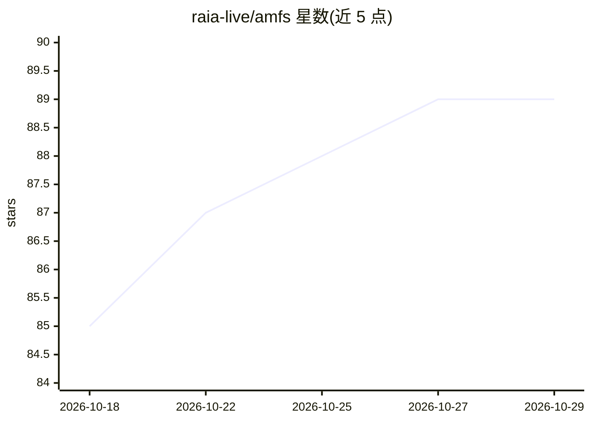

# raia-live/amfs

⭐ 89 · Python · Apache-2.0 · 推送 2026-10-26 · [GitHub](https://github.com/raia-live/amfs) · [官网](https://www.sense-lab.ai) · 组织维护

**AI agent 的递归自我改进引擎：每次运行产出经验供下次运行使用**

面向 AI agent 开发者的记忆与学习引擎：每次运行记录决策轨迹（请求、依赖、动作、结果），运行结束后按结果调整各条目的置信度，下一次运行前返回简报与动作建议（act/explore/escalate）。条目带证据状态（untested/validated/contested/discredited）与按时间、类型、结果、读取频率衰减的置信度。存储支持文件系统（零配置）、Postgres+pgvector、S3；提供 Python/TypeScript SDK、40 工具的 MCP 服务器、HTTP 服务器与 Docker 部署。改进限定于运行时简报与先验，非开放式能力增长；完整回路需 Postgres 与 Cortex worker。

## 筛选速览

| 维度 | 判定 | 备注 |
|---|---|---|
| AI 角色 | `ai-ecosystem` | LLM/agent 周边工具 |
| 许可风险 | `permissive` | Apache-2.0 |
| 部署形态 | `self-host` | docker 或自建部署 |
| 模型依赖 | — | README 未给出锁定关系 |
| 硬件要求 | — | 无带数字的原话,不猜 |
| 安装摩擦 | `low` | 无编译、无系统依赖或容器化 |
| 成熟度 | — | 结构信号不足 |

## 能力要点

- 决策轨迹记录与 record_attempt() 区分失败/恢复归因
- briefing()/retrieve() 混合检索返回动作建议与 regime shift 检测
- 四类条目（fact/belief/experience/procedure）与四信号置信度衰减
- MCP 服务器 40 工具、REST API、CLI、Docker 镜像，多框架集成钩子

## 适用场景

- 让部署/运维类 agent 不重复踩同样的坑
- 为编码 agent（Cursor/Claude Code 等）通过 MCP 提供经验记忆
- 团队多 agent 共享自托管的知识与简报服务

## 场景标签

`Agent 记忆` · 领域:Agent 开发

## 证据(README 行号)

> L104:  Agents over MCP, frameworks and SDKs on top; the engine in the middle with record, recall and learn; filesystem, 
> L149: |`amfs-integrations-strands`, `-crewai`, `-langgraph`, `-langchain`, `-autogen`|Framework hooks. See Strands and C
> L3:  The recursive self-improvement engine for AI agents

## 星数曲线

2026-10-18 85 → 2026-10-29 89（+4）

---
*卡片 v1 · prompt 1.4 · 生成 2026-10-23 · 置信度 high · 依据 README sha `478acf098dd3` · [字段定义](../../DATASET.md)*
