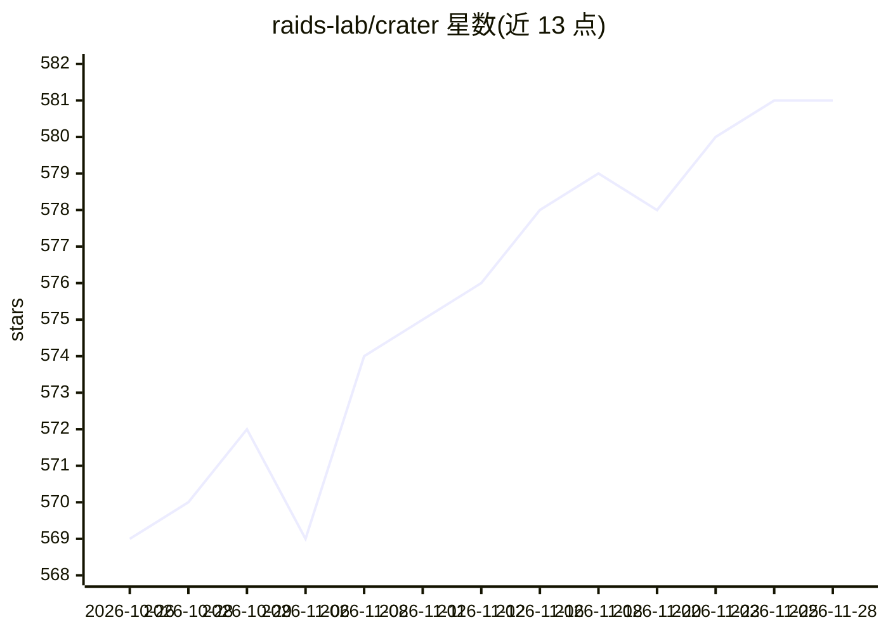

# raids-lab/crater

⭐ 581 · Go · Apache-2.0 · 推送 2026-11-27 · [GitHub](https://github.com/raids-lab/crater) · [官网](https://raids-lab.github.io/crater/en/) · 组织维护 · 中文 README

**面向 GPU 集群共享团队的 Kubernetes AI 训练推理管控平台**

构建在 Kubernetes 与 Volcano 之上的控制平面，用于运营多团队共享的 GPU 集群：提供用户/账户/队列/配额/审批等治理，基于队列的准入与优先级调度，作业模板与提交、克隆、停止等生命周期管理，Jupyter/WebIDE 交互式开发环境，数据集/模型/镜像资产管理，以及指标、日志、Grafana 面板的观测能力。支持 NVIDIA GPU、国产加速卡、vGPU 类资源的异构调度。通过 Helm 部署，提供 Web 控制台、CLI、HTTP API 与面向 Agent 的命令技能。面向高校、科研机构、企业 AI 团队与内部平台团队。

## 筛选速览

| 维度 | 判定 | 备注 |
|---|---|---|
| AI 角色 | `ai-ecosystem` | LLM/agent 周边工具 |
| 许可风险 | `permissive` | Apache-2.0 |
| 部署形态 | `library` | 以包/库形式分发 |
| 模型依赖 | — | README 未给出锁定关系 |
| 硬件要求 | — | 无带数字的原话,不猜 |
| 安装摩擦 | `low` | 无编译、无系统依赖或容器化 |
| 成熟度 | — | 结构信号不足 |

## 能力要点

- 多租户治理：用户、账户、队列、配额、审批与成本可见性
- 基于 Kubernetes 与 Volcano 的队列准入与优先级调度
- 异构加速器：NVIDIA GPU、国产加速卡、vGPU 类资源与 DRA/CDI 设备集成
- Web 控制台、CLI、HTTP API 与面向 Agent 的命令技能四种操作界面

## 适用场景

- 高校实验室多团队共享 GPU 集群的配额与队列管理
- 为大模型微调与推理服务提供快速部署模板
- 课程教学场景下的学生账号、配额与 Web 作业提交
- 数据集准备与离线批处理管线的调度与观测

## 场景标签

 · 领域:AI 基础设施/集群管控平台

## 证据(README 行号)

> L5: ### A Kubernetes-native control plane for shared AI computing clusters
> L37: **Crater** is a Kubernetes-native platform for operating shared AI computing clusters. It helps organizations manag
> L39: Crater is designed for environments where different teams and workloads share the same GPU cluster: long-running tr

## 星数曲线

2026-10-26 569 → 2026-11-28 581（+12）

---
*卡片 v1 · prompt 1.4 · 生成 2026-11-28 · 置信度 high · 依据 README sha `b23aa01d12fa` · [字段定义](../../DATASET.md)*
