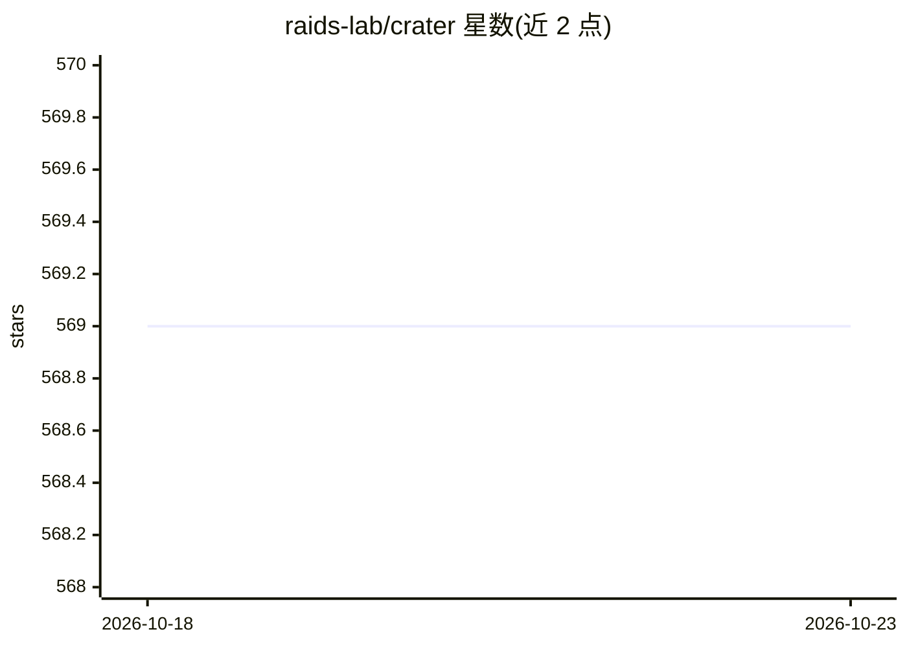

# raids-lab/crater

⭐ 569 · Go · Apache-2.0 · 推送 2026-10-19 · [GitHub](https://github.com/raids-lab/crater) · [官网](https://raids-lab.github.io/crater/en/) · 组织维护 · 中文 README

**Kubernetes 原生的共享 AI 算力集群管理平台**

面向高校、科研机构与企业 AI 团队的共享 GPU 集群控制平面：在 Kubernetes 与 Volcano 之上提供多租户治理（账户/队列/配额/审批）、策略感知调度、训练与推理作业生命周期管理、容器化 Jupyter/WebIDE 交互开发、数据集与模型资产管理，以及 LLM 快速部署与推理网关。通过 Web 控制台、CLI、HTTP API 和 agent 命令技能操作，并以 Helm Chart 部署，集成 Prometheus/Grafana 观测。支持 NVIDIA GPU、国产加速卡与 vGPU 类资源。

## 筛选速览

| 维度 | 判定 | 备注 |
|---|---|---|
| AI 角色 | `ai-ecosystem` | LLM/agent 周边工具 |
| 许可风险 | `permissive` | Apache-2.0 |
| 部署形态 | `library` | 以包/库形式分发 |
| 模型依赖 | — | README 未给出锁定关系 |
| 硬件要求 | — | 无带数字的原话,不猜 |
| 安装摩擦 | `low` | 无编译、无系统依赖或容器化 |
| 成熟度 | — | 结构信号不足 |

## 能力要点

- 多租户治理：账户、队列、配额、审批与计费导向的资源可见性
- 基于 Kubernetes 与 Volcano 的队列准入、优先级与异构资源调度
- LLM 训练/推理快速部署模板与推理网关
- Web/CLI/HTTP API/agent 命令技能多入口操作

## 适用场景

- 高校或研究所把共享 GPU 集群变成可问责的多团队服务
- 企业内部平台团队统一管理训练、推理与交互式开发作业
- 快速部署 LLM 微调与推理服务并治理算力配额

## 场景标签

 · 领域:AI 基础设施/云原生平台

## 证据(README 行号)

> L7: Operate shared **GPU clusters**, **LLM training and serving workloads**, **developer environments**, and **data/mode
> L37: **Crater** is a Kubernetes-native platform for operating shared AI computing clusters. It helps organizations manag
> L96:  🤖 LLM &amp; AI Service Platform

## 星数曲线

2026-10-18 569 → 2026-10-23 569（+0）

---
*卡片 v1 · prompt 1.4 · 生成 2026-10-21 · 置信度 high · 依据 README sha `393e7aaa26fd` · [字段定义](../../DATASET.md)*
