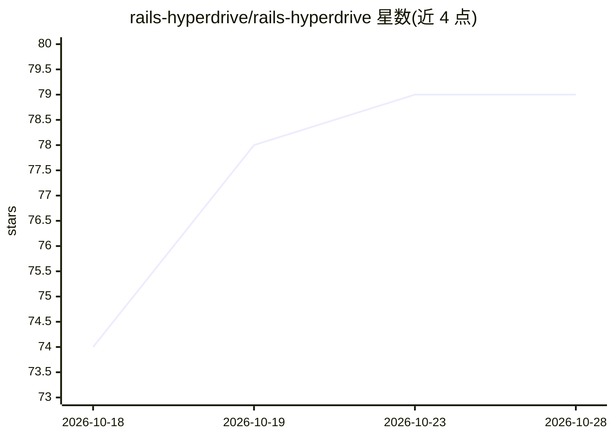

# rails-hyperdrive/rails-hyperdrive

⭐ 79 · Ruby · MIT · 推送 2026-10-02 · [GitHub](https://github.com/rails-hyperdrive/rails-hyperdrive) · 组织维护

**开发期 Rails 引擎：向 AI 编码 agent 提供应用实时内省与栈匹配技能**

开发环境专用的 Rails engine，通过在 /_hyperdrive/mcp 挂载 MCP 服务器，向 AI 编码 agent 提供 8 个工具（eval Ruby、只读 SQL、tail 日志、列出模型/路由、定位源码、查 RDoc、栈快照）和 2 个资源；另含发现机制，安装来自 companion gem 且与 Gemfile 版本匹配的 skills/guidelines/agents/commands 四类内容到 .claude/ 目录。内置 Bundler 插件在 bundle install 时自动同步，hyperdrive:sync 支持 merge/sidecar/resolve 等冲突策略，可配置外部命令（如 claude）自动合并 sidecar。本体不携带任何技能内容，仅提供机制与契约。由 Evil Martians 咨询公司开发。

## 筛选速览

| 维度 | 判定 | 备注 |
|---|---|---|
| AI 角色 | `ai-ecosystem` | LLM/agent 周边工具 |
| 许可风险 | `permissive` | MIT |
| 部署形态 | `library` | 以包/库形式分发 |
| 模型依赖 | — | README 未给出锁定关系 |
| 硬件要求 | — | 无带数字的原话,不猜 |
| 安装摩擦 | `low` | 无编译、无系统依赖或容器化 |
| 成熟度 | — | 结构信号不足 |

## 能力要点

- MCP 服务器提供 8 个工具：eval Ruby、只读 SQL、tail 日志、列出模型/路由、定位源码、栈快照等
- 按 Gemfile 版本匹配安装 companion gem 中的 skills/guidelines/agents/commands 四类内容
- Bundler 插件在 bundle install 时自动落装工件，版本冲突经 git 三方 merge/sidecar/外部 resolve 命令处理
- 本体零内容：仅提供契约与发现/安装引擎

## 适用场景

- 让 AI 编码 agent 查询运行中 Rails 应用的真实路由、schema 与模型信息
- 把与当前依赖栈匹配的领域指导（如 Sidekiq）注入 agent 上下文
- 在 bundle 更新后自动同步 agent 使用的技能与指导文件

## 场景标签

 · 领域:开发工具/AI agent 基础设施

## 证据(README 行号)

> L9: Rails Hyperdrive is a development-only Rails engine for working on Rails apps with AI coding agents. It gives the ag
> L11: - **Live introspection.** The engine mounts an MCP (Model Context Protocol) server at `http://localhost:3000/_hyper
> L14: **rails-hyperdrive is the mechanism; companion gems are the content.** The gem itself ships no skills or guidelines

## 星数曲线

2026-10-18 74 → 2026-10-28 79（+5）

---
*卡片 v1 · prompt 1.4 · 生成 2026-10-24 · 置信度 mid · 依据 README sha `1ad35480d4d9` · [字段定义](../../DATASET.md)*
