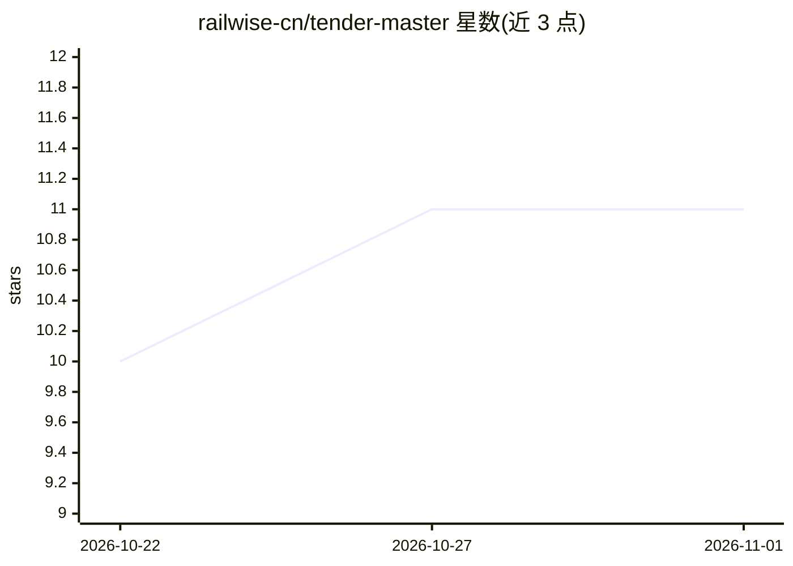

# railwise-cn/tender-master

⭐ 11 · Python · MIT · 推送 2026-07-24 · [GitHub](https://github.com/railwise-cn/tender-master) · 组织维护 · 中文 README

**供 coding agent 调用的招投标技术标编制 Skill 与智能体**

以 SKILL.md 为主入口的技能包，供 Claude Code / Codex / Cursor / OpenClaw 等 coding agent 加载后执行九步招投标编制流程：招标解析、标的模式判定、评分镜像目录、风控台账、逐章撰写、质检与五专家评审、DOCX 排版整合。目录设计为评分表镜像，风控条款与正文物理隔离，资质/案例等用占位符不编造。配套无依赖质检脚本与可选 python 脚本，脚本不可用时仍可手动推进。价格报价由人工核定，纯施工标不在覆盖范围。

## 筛选速览

| 维度 | 判定 | 备注 |
|---|---|---|
| AI 角色 | `ai-native` | 本体是模型或模型工具 |
| 许可风险 | `permissive` | MIT |
| 部署形态 | `library` | 以包/库形式分发 |
| 模型依赖 | — | README 未给出锁定关系 |
| 硬件要求 | — | 无带数字的原话,不猜 |
| 安装摩擦 | `low` | 无编译、无系统依赖或容器化 |
| 成熟度 | — | 结构信号不足 |

## 能力要点

- 九步流程管控，每步独立产出文件，用户确认后推进
- 评分镜像目录与技术响应表 T-NNN 贯穿目录→提示词→正文
- 风控与正文物理隔离，资质/案例用占位符不编造
- 五专家评审与无第三方依赖的质检脚本 bid_quality_check.py

## 适用场景

- 让 Claude Code 等 agent 按标准化流程编制技术标书
- 工程监测/测绘类标书套用 16 章标准格式与专属章节骨架
- 编制后自动质检并整合输出 DOCX 成果文件

## 场景标签

`AI 写作` · 领域:内容生成

## 证据(README 行号)

> L3: 一个可供 coding agent（Claude Code / Codex / Cursor / OpenClaw 等）调用的**标准化招投标编制** skill 与智能体，由四个成熟招投标项目融合而成，取各家所长：
> L33: ├── SKILL.md                        # 主入口：角色、九步流程、权限红线、资源索引
> L69: - **技术标**（主线，九步流程全覆盖）

## 星数曲线

2026-10-22 10 → 2026-11-01 11（+1）

---
*卡片 v1 · prompt 1.4 · 生成 2026-11-01 · 置信度 mid · 依据 README sha `e8e10a24f4d8` · [字段定义](../../DATASET.md)*
