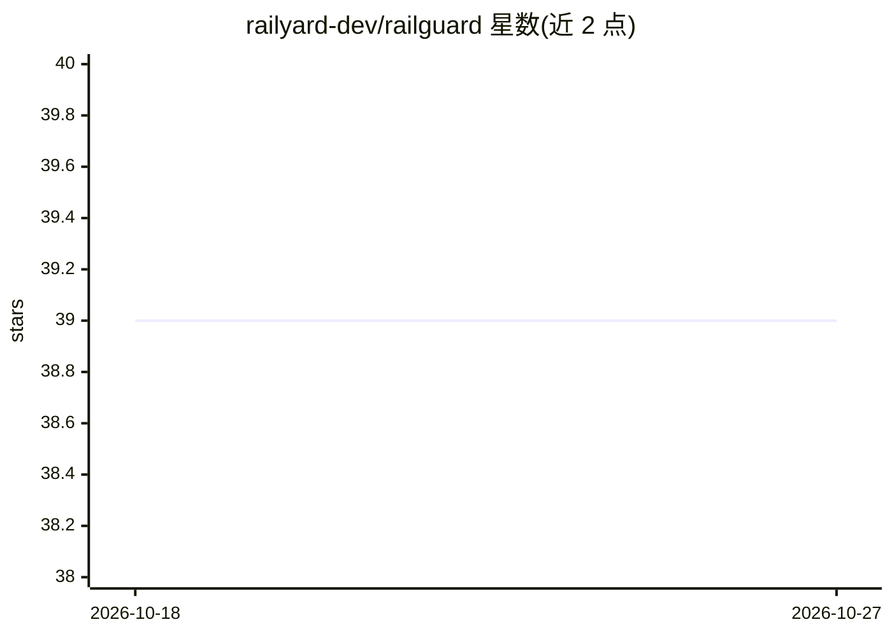

# railyard-dev/railguard

⭐ 39 · Rust · MIT · 推送 2026-03-23 · [GitHub](https://github.com/railyard-dev/railguard) · [官网](https://www.railguard.tech) · 组织维护

**Claude Code 的安全运行时：拦截工具调用，2ms 内放行/拦截/询问**

Rust 编写的 Claude Code 沙箱运行时，替代 --dangerously-skip-permissions 的全有全无模式：拦截 Bash、Read、Write、Edit、Memory 等所有工具调用，在毫秒级判定 allow/block/ask，同一命令按上下文（项目内外路径）给出不同决定。防护机制含语义规则层与 OS 层沙箱（macOS sandbox-exec / Linux bwrap），并对 Claude Code 持久化记忆写入做分类签名与篡改检测。附带路径围栏、多代理文件锁、监控面板与会话回滚。通过 cargo install 安装。

## 筛选速览

| 维度 | 判定 | 备注 |
|---|---|---|
| AI 角色 | `ai-ecosystem` | LLM/agent 周边工具 |
| 许可风险 | `permissive` | MIT |
| 部署形态 | `library` | 以包/库形式分发 |
| 模型依赖 | locked-api |  |
| 硬件要求 | — | 无带数字的原话,不猜 |
| 安装摩擦 | `low` | 无编译、无系统依赖或容器化 |
| 成熟度 | — | 结构信号不足 |

## 能力要点

- 拦截全部工具调用并在 2ms 内判定 allow/block/ask
- OS 级沙箱（sandbox-exec / bwrap）解析实际执行命令，防绕过
- 对 Claude 持久记忆写入做分类（密钥/行为指令/事实）与内容哈希签名
- 路径围栏、文件快照回滚、实时监控面板与会话回放

## 适用场景

- 给 Claude Code 开放自动执行权限但拦截危险命令与敏感路径访问
- 防止 agent 向持久记忆注入行为指令或外泄密钥
- 多 agent 并行会话下用文件锁协调并回滚误操作

## 场景标签

`网络安全` · 领域:学习与行业

## 证据(README 行号)

> L7:  Safe runtime for Claude Code, built to be yours.
> L19: --dangerously-skip-permissions is all-or-nothing. Either you approve every tool call by hand, or Claude runs with z
> L32: Railguard intercepts every tool call and decides in under 2ms: allow, block, or ask.

## 星数曲线

2026-10-18 39 → 2026-10-27 39（+0）

---
*卡片 v1 · prompt 1.4 · 生成 2026-10-25 · 置信度 mid · 依据 README sha `1e517ae1c955` · [字段定义](../../DATASET.md)*
