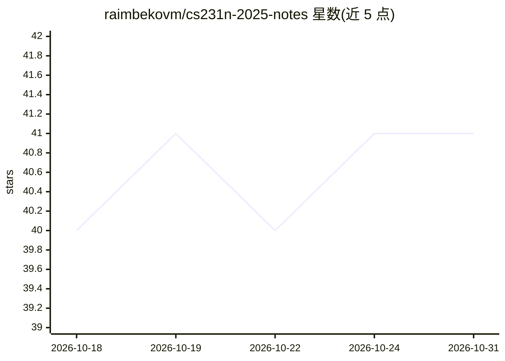

# raimbekovm/cs231n-2025-notes

⭐ 41 · Python · MIT · 推送 2026-10-15 · [GitHub](https://github.com/raimbekovm/cs231n-2025-notes) · [官网](https://raimbekovm.github.io/cs231n-2025-notes/) · 个人维护

**Stanford CS231n 2025 课程深度学习讲义（非官方续写）**

基于 Stanford CS231n 2025 春季课程（计算机视觉深度学习）编写的完整讲义，覆盖 18 讲：线性分类器、CNN、RNN、Transformer、检测分割、生成模型、3D 视觉、视觉语言、机器人学习等。官方讲义自 2017 年停止更新，本讲义补充了 Vision Transformer、对比学习预训练、潜在扩散等内容；每章为独立成文推导，并链接原始论文。提供在线阅读、单文件 PDF 下载与全文搜索站点；非 Stanford 官方资源，MIT 许可，接受社区纠错贡献。

## 筛选速览

| 维度 | 判定 | 备注 |
|---|---|---|
| AI 角色 | `ai-knowledge` | 知识聚合/清单类 |
| 许可风险 | `permissive` | MIT |
| 部署形态 | `None` |  |
| 模型依赖 | — | README 未给出锁定关系 |
| 硬件要求 | — | 无带数字的原话,不猜 |
| 安装摩擦 | `low` | 无编译、无系统依赖或容器化 |
| 成熟度 | — | 结构信号不足 |

## 能力要点

- 18 讲完整覆盖 2025 版 CS231n 课程大纲
- 含 2017 年后新内容：ViT、对比预训练、潜在扩散、视觉语言模型
- 每个结果链接到原始论文，章节可编号直链
- 提供单文件 PDF 与带全文搜索的在线站点

## 适用场景

- 系统学习计算机视觉与深度学习课程内容
- 查证 2017 年官方讲义未覆盖的新方向（ViT/扩散/CLIP 等）
- 按讲次定位论文出处并延伸阅读

## 场景标签

`教程课程` · 领域:学习与行业

## 证据(README 行号)

> L5:  Free, in-depth lecture notes for Stanford CS231n: Deep Learning for Computer Vision (Spring 2025).
> L6:  CNNs, RNNs, Transformers, object detection and segmentation — written to be read, not skimmed.

## 星数曲线

2026-10-18 40 → 2026-10-31 41（+1）

---
*卡片 v1 · prompt 1.4 · 生成 2026-10-25 · 置信度 high · 依据 README sha `aff8c6e6e4f1` · [字段定义](../../DATASET.md)*
