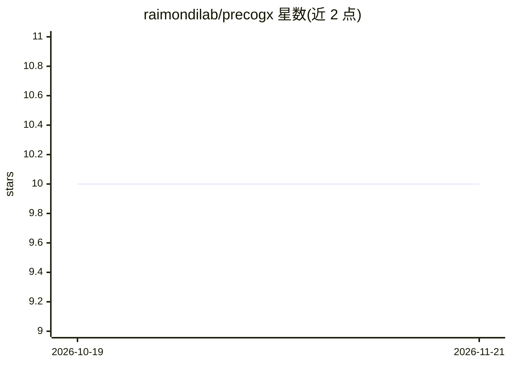

# raimondilab/precogx

⭐ 10 · JavaScript · GPL-3.0 · 推送 2026-10-23 · [GitHub](https://github.com/raimondilab/precogx) · [官网](https://precogx.bioinfolab.sns.it/) · 组织维护

**预测 GPCR 与 G 蛋白/β-arrestin 偶联的 Transformer 工具**

基于 ESM1b 蛋白质嵌入与公开结合数据集训练的机器学习工具（PRECOGx），提供网页版与命令行两种使用方式：输入 GPCR 序列后预测其与各 G 蛋白及 β-arrestin 的偶联概率，并将序列投影到人类 GPCRome 的低维嵌入空间；输出面板包括偶联概率表、PCA、差异接触对热图、注意力图与 NGL 3D 结构查看，可评估疾病变异与可变剪接的影响。以 conda 环境运行，依赖 Flask 搭建本地 Web 应用。

## 筛选速览

| 维度 | 判定 | 备注 |
|---|---|---|
| AI 角色 | `ai-native` | 本体是模型或模型工具 |
| 许可风险 | `viral` | GPL-3.0 |
| 部署形态 | `library` | 以包/库形式分发 |
| 模型依赖 | — | README 未给出锁定关系 |
| 硬件要求 | — | 无带数字的原话,不猜 |
| 安装摩擦 | `low` | 无编译、无系统依赖或容器化 |
| 成熟度 | — | 结构信号不足 |

## 能力要点

- 使用 ESM1b 蛋白语言模型嵌入作为特征预测 GPCR 偶联概率
- 支持变异与可变剪接形式的偶联影响评估
- 输出包含注意力图与预测分子内接触的结构分析面板
- 同时提供 Web 应用与命令行（precogx.py）两种运行方式

## 适用场景

- 预测 GPCR 序列与 G 蛋白/β-arrestin 的偶联偏好
- 分析突变对受体信号转导的影响
- 在 3D 结构上查看介导偶联的关键残基接触对

## 场景标签

`科研工具` · 领域:学习与行业

## 证据(README 行号)

> L5: The protein language models encode structural and functional information of GPCR sequences that can be used to predi
> L6: 1. Predict GPCR (all classes) interactions with G protein and β-arrestin
> L70: ./static/predictor/precogx.py all --file <inputFile>

## 星数曲线

2026-10-19 10 → 2026-11-21 10（+0）

---
*卡片 v1 · prompt 1.4 · 生成 2026-11-19 · 置信度 mid · 依据 README sha `2e9dcf80b803` · [字段定义](../../DATASET.md)*
