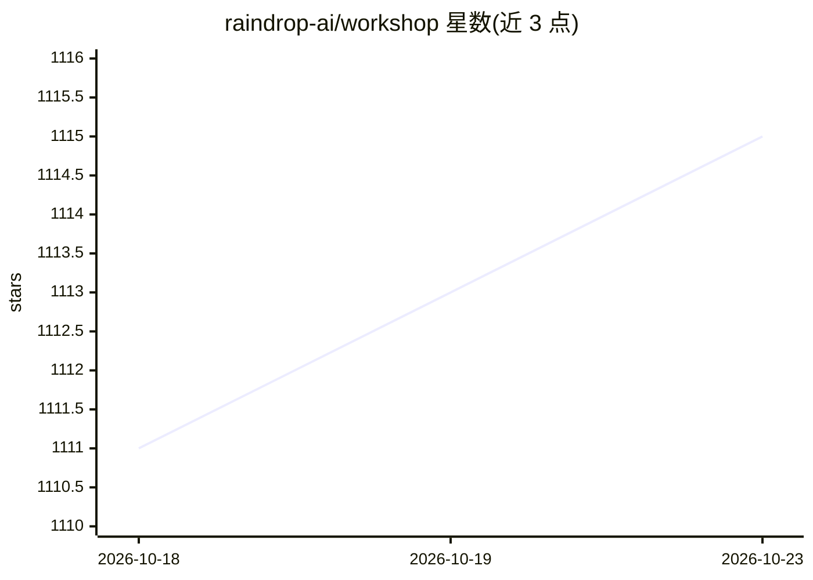

# raindrop-ai/workshop

⭐ 1,115 · TypeScript · MIT · 推送 2026-10-22 · [GitHub](https://github.com/raindrop-ai/workshop) · [官网](https://www.raindrop.ai/workshop/) · 组织维护

**给编码 agent 用的本地调试器：实时追踪与写评测**

Raindrop 出品的本地 agent 调试工具：通过 /instrument-agent 给编码 agent 接入 Raindrop tracing，token、工具调用与 span 实时流式进入浏览器 UI；Claude Code 可读取追踪、针对代码库编写 eval，形成写 eval→跑 agent→看失败→修代码→重跑的自愈循环；/setup-agent-replay 可搭建 HTTP 端点在生产 trace 上回放。一条 curl 命令安装并启动本地守护进程，另有 Raindrop Cloud 托管产品可选接入。MIT 许可。

## 筛选速览

| 维度 | 判定 | 备注 |
|---|---|---|
| AI 角色 | `ai-ecosystem` | LLM/agent 周边工具 |
| 许可风险 | `permissive` | MIT |
| 部署形态 | `None` |  |
| 模型依赖 | — | README 未给出锁定关系 |
| 硬件要求 | — | 无带数字的原话,不猜 |
| 安装摩擦 | `low` | 无编译、无系统依赖或容器化 |
| 成熟度 | — | 结构信号不足 |

## 能力要点

- token/工具调用/span 实时流式进入本地 UI，无需轮询刷新
- Claude Code 读取追踪并对代码库编写 eval 的自愈循环
- /setup-agent-replay 脚手架：生产 trace 回放到真实 agent 代码
- 本地 Workshop 与 Raindrop Cloud 共存，安装注册表互不覆盖

## 适用场景

- 调试编码 agent 的每一步决策与工具调用
- 让 Claude Code 基于追踪数据写 eval 并自动修复代码
- 将生产 trace 回放到本地 agent 代码复现问题

## 场景标签

`LLM 可观测性` `模型评测` · 领域:评测与运维

## 证据(README 行号)

> L38: - **Live streamed traces.** Every token, tool call, and span streams into
> L40: - **Coding-agent integration.** Claude Code reads your traces, writes evals
> L43:  failure, fixes the code, and re-runs until every assertion passes.

## 星数曲线

2026-10-18 1,111 → 2026-10-23 1,115（+4）

---
*卡片 v1 · prompt 1.4 · 生成 2026-10-21 · 置信度 high · 依据 README sha `d201a448d3fe` · [字段定义](../../DATASET.md)*
