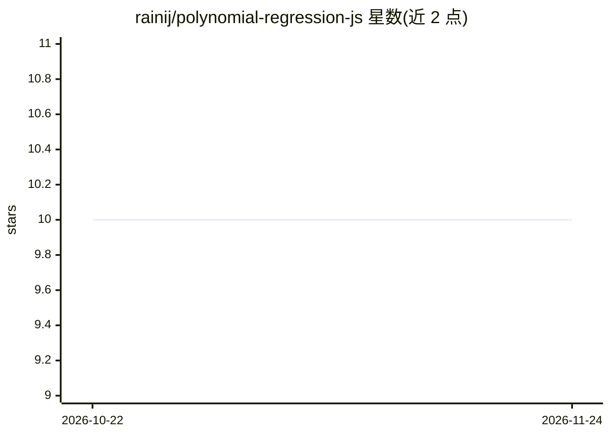

# rainij/polynomial-regression-js

⭐ 10 · TypeScript · MIT · 推送 2026-09-13 · [GitHub](https://github.com/rainij/polynomial-regression-js) · 个人维护

**JS/TS 多元多项式回归库，用于数据拟合预测**

TypeScript 编写的回归库，提供 PolynomialRegressor 类执行多变量线性与多项式回归，以及 PolynomialFeatures 类将输入特征转换为多项式特征；附 TypeDoc 生成的 API 文档，通过 npm 安装，README 含线性与特征转换的使用示例。适用于需要在 JavaScript/TypeScript 环境中做回归建模的开发者。

## 筛选速览

| 维度 | 判定 | 备注 |
|---|---|---|
| AI 角色 | `ai-native` | 本体是模型或模型工具 |
| 许可风险 | `permissive` | MIT |
| 部署形态 | `library` | 以包/库形式分发 |
| 模型依赖 | — | README 未给出锁定关系 |
| 硬件要求 | — | 无带数字的原话,不猜 |
| 安装摩擦 | `low` | 无编译、无系统依赖或容器化 |
| 成熟度 | — | 结构信号不足 |

## 能力要点

- 提供 PolynomialRegressor 多变量多项式回归类
- 提供 PolynomialFeatures 多项式特征转换类
- TypeScript 编写并附 TypeDoc API 文档

## 适用场景

- 在 Node.js 或前端项目中拟合多变量多项式模型
- 对输入特征做多项式展开后供回归使用
- 替代手写回归算法进行数值预测

## 场景标签

 · 领域:机器学习/数据分析

## 证据(README 行号)

> L6: **polynomial-regression-js** is a typescript library for linear and polynomial regression
> L8: [PolynomialRegressor][doc-polynomial-regressor-url] for multivariate polynomial regression

## 星数曲线

2026-10-22 10 → 2026-11-24 10（+0）

---
*卡片 v1 · prompt 1.4 · 生成 2026-11-19 · 置信度 high · 依据 README sha `d9c2cfdfdd45` · [字段定义](../../DATASET.md)*
