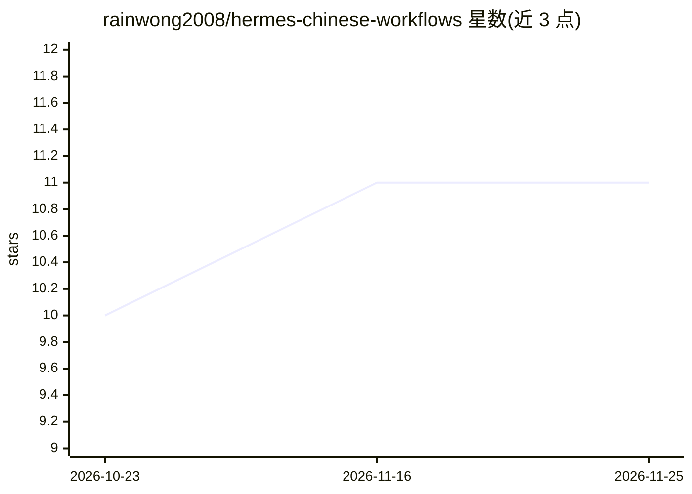

# rainwong2008/hermes-chinese-workflows

⭐ 11 · Python · MIT · 推送 2026-04-28 · [GitHub](https://github.com/rainwong2008/hermes-chinese-workflows) · 个人维护 · 中文 README

**基于 Hermes Agent 的中文自动化工作流模板合集**

为 Hermes Agent 框架提供五套中文工作流模板：微信公众号自动化、产品调研、社群运营、内容创作、行业动态监控。每套包含 Skill 配置文件、Cron 任务配置、Python/Shell 辅助脚本与模板文件，复制到 `~/.hermes/skills/` 或导入 Hermes 后运行。依赖用户预先安装 Hermes Agent 并完成 `hermes setup`，主要运行成本为 LLM API 调用费；Skill 为 Markdown 文件可编辑，支持 fork 后自定义。

## 筛选速览

| 维度 | 判定 | 备注 |
|---|---|---|
| AI 角色 | `ai-knowledge` | 知识聚合/清单类 |
| 许可风险 | `permissive` | MIT |
| 部署形态 | `None` |  |
| 模型依赖 | — | README 未给出锁定关系 |
| 硬件要求 | — | 无带数字的原话,不猜 |
| 安装摩擦 | `low` | 无编译、无系统依赖或容器化 |
| 成熟度 | — | 结构信号不足 |

## 能力要点

- 五套工作流：公众号发文、产品调研、社群运营、内容创作、行业监控
- 每套含 Skill 配置、Cron 任务与 Python/Shell 辅助脚本
- Skill 均为 Markdown 文件，可直接编辑与 fork 修改
- 消息平台支持飞书/Telegram/Discord，图片生成支持 DALL-E/Midjourney

## 适用场景

- 一人公司用 AI 每日自动产出公众号文章
- 监控 RSS 信息源并定期生成调研周报
- 付费社群的定时推送与互动话题自动化
- 独立开发者自动化内容排版与配图流程

## 场景标签

`工作流自动化` `AI 写作` · 领域:效率与自动化

## 证据(README 行号)

> L13: 这是一套基于 Hermes Agent 的中文实战工作流模板。
> L15: 不是教程，不是翻译文档 — 是**可以直接用的完整配置**。
> L17: 每个工作流都经过真实业务验证，包含：

## 星数曲线

2026-10-23 10 → 2026-11-25 11（+1）

---
*卡片 v1 · prompt 1.4 · 生成 2026-11-18 · 置信度 mid · 依据 README sha `108ccc0013fe` · [字段定义](../../DATASET.md)*
