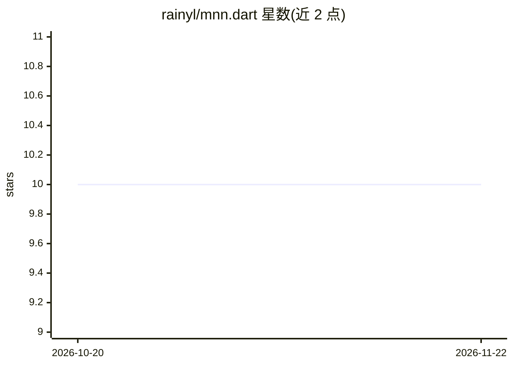

# rainyl/mnn.dart

⭐ 10 · C++ · Apache-2.0 · 推送 2026-10-15 · [GitHub](https://github.com/rainyl/mnn.dart) · [官网](https://pub.dev/packages/mnn) · 个人维护

**让 Dart/Flutter 应用运行 MNN 推理模型的封装库**

MNN 的 Dart 封装（wrapper），提供在 Dart 中加载并推理 MNN 模型的接口，支持 Native-Assets。以 pub 包形式发布，示例通过 dart run 运行。README 未列模型类型、后端支持范围与性能数据；TODO 显示异步、pubspec.yaml 自定义构建配置、更多 backend 支持尚未完成。维护者为个人（rainyl），许可证 Apache-2.0。

## 筛选速览

| 维度 | 判定 | 备注 |
|---|---|---|
| AI 角色 | `ai-ecosystem` | LLM/agent 周边工具 |
| 许可风险 | `permissive` | Apache-2.0 |
| 部署形态 | `None` |  |
| 模型依赖 | — | README 未给出锁定关系 |
| 硬件要求 | — | 无带数字的原话,不猜 |
| 安装摩擦 | `low` | 无编译、无系统依赖或容器化 |
| 成熟度 | — | 结构信号不足 |

## 能力要点

- 在 Dart 中推理 MNN 模型
- 支持 Native-Assets
- 提供 Flutter/Dart 包使用方式

## 适用场景

- 在 Flutter 移动应用中加载并运行 MNN 模型
- 在 Dart 命令行程序中执行模型推理

## 场景标签

`推理引擎` · 领域:训练与推理

## 证据(README 行号)

> L3: A Dart wapper for MNN.
> L7: - Inference MNN models in Dart.

## 星数曲线

2026-10-20 10 → 2026-11-22 10（+0）

---
*卡片 v1 · prompt 1.4 · 生成 2026-11-19 · 置信度 mid · 依据 README sha `c13e686a6d5e` · [字段定义](../../DATASET.md)*
