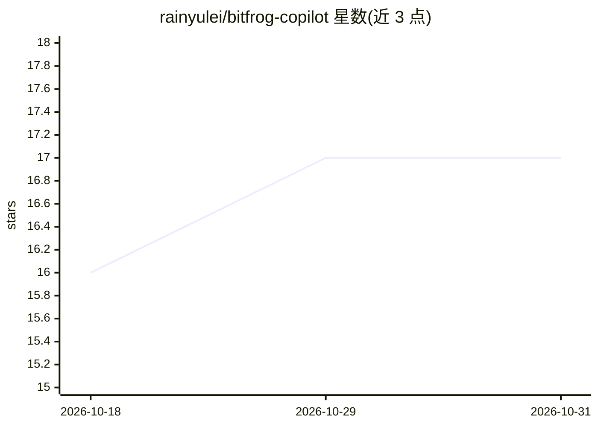

# rainyulei/bitfrog-copilot

⭐ 17 · TypeScript · MIT · 推送 2026-03-30 · [GitHub](https://github.com/rainyulei/bitfrog-copilot) · 个人维护 · 中文 README

**为 GitHub Copilot 提供 7+1 个结构化开发 agent 的插件**

运行在 VS Code Copilot Chat 内的 agent 插件，提供 7 个专用 agent（brainstorm/plan/execute/debug/review/mentor）加自动路由的 @bitfrog，覆盖从想法到交付的各阶段并自动交接；v4.3 新增墨子（Mozi）自治端到端执行 agent（BETA）。agent 设计基于中国哲学思维模型（中庸之道、格物致知等五原则），支持 TDD 任务分解、并行子 agent 与代码审查。通过 VS Code 插件市场或 Chat 插件命令安装，推荐 GPT-5.4 模型，支持英文与简体中文。

## 筛选速览

| 维度 | 判定 | 备注 |
|---|---|---|
| AI 角色 | `ai-ecosystem` | LLM/agent 周边工具 |
| 许可风险 | `permissive` | MIT |
| 部署形态 | `None` |  |
| 模型依赖 | — | README 未给出锁定关系 |
| 硬件要求 | — | 无带数字的原话,不猜 |
| 安装摩擦 | `low` | 无编译、无系统依赖或容器化 |
| 成熟度 | `idea` | |

## 能力要点

- 7+1 专用 agent 分阶段协作并自动路由
- 墨子自治 agent（BETA）：调查-执行-自验证直到目标达成
- 基于五条中国哲学原则的 agent 思维模型
- execute 阶段支持并行子 agent 的 TDD 实现

## 适用场景

- 在必须使用 Copilot 的企业环境中获得结构化开发工作流
- 从想法到上线按 brainstorm→plan→execute→review 流程开发功能
- 给一个明确目标让 Mozi 自治端到端完成
- 通过 mentor agent 以提示方式学习而非直接要答案

## 场景标签

`编码 Agent` `代码审查` · 领域:编码与开发

## 证据(README 行号)

> L19: **BitFrog gives you Claude Code-level structured development workflows, running entirely inside GitHub Copilot.**
> L23: BitFrog adds **7+1 specialized agents** directly inside Copilot Chat. Each handles one phase of development, handin

## 星数曲线

2026-10-18 16 → 2026-10-31 17（+1）

---
*卡片 v1 · prompt 1.4 · 生成 2026-10-30 · 置信度 high · 依据 README sha `412fc0515f37` · [字段定义](../../DATASET.md)*
