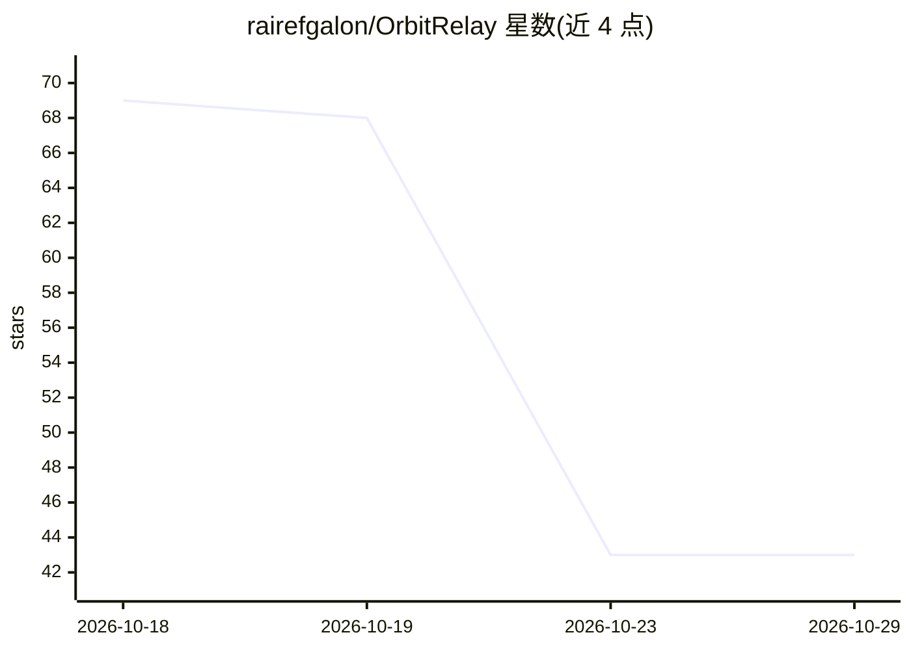

# rairefgalon/OrbitRelay

⭐ 43 · Python · NOASSERTION · 推送 2026-09-04 · [GitHub](https://github.com/rairefgalon/OrbitRelay) · [官网](https://mlabonne.github.io/blog/) · 个人维护

**多智能体交接记录检查器：评分上下文完整性并生成审查档案**

面向多智能体系统开发与运维的离线检查工具：读取 JSON 格式的会话交接记录，按目标角色契约对每个交接中传递的上下文字段分类，计算加权惩罚的完整性得分（区分缺失/空置/多余字段），检测延迟、fan-in/fan-out、返工四类协调瓶颈，并输出 Markdown 审查档案。Python 3.11 标准库实现，另有 .NET 9 独立分析器做交叉复核；全程无网络、无随机性，结果确定可复现。

## 筛选速览

| 维度 | 判定 | 备注 |
|---|---|---|
| AI 角色 | `ai-ecosystem` | LLM/agent 周边工具 |
| 许可风险 | `none` | NOASSERTION |
| 部署形态 | `None` |  |
| 模型依赖 | — | README 未给出锁定关系 |
| 硬件要求 | — | 无带数字的原话,不猜 |
| 安装摩擦 | `medium` | 含编译或系统依赖之一 |
| 成熟度 | — | 结构信号不足 |

## 能力要点

- 五阶段纯函数流水线：load→inspect→score→bottlenecks→dossier
- 加权完整性评分：缺失 0.60 / 空置 0.30 / 多余 0.10，映射 A–F 等级
- 四类确定性瓶颈检测（latency/fan_in/fan_out/rework）
- Python 与 .NET 9 双实现交叉复核完整性得分

## 适用场景

- 多智能体会话回归审查时定位丢上下文的交接点
- 在 CI 中对交接完整性设阈值门禁
- 事故复盘时生成附带的对话流审查档案

## 场景标签

`模型评测` · 领域:评测与运维

## 证据(README 行号)

> L18: OrbitRelay treats the relay boundary as a first-class object. It ingests a recorded
> L105: The pipeline is `load → inspect → score → bottlenecks → dossier`. Every stage is a pure

## 星数曲线

2026-10-18 69 → 2026-10-29 43（-26）

---
*卡片 v1 · prompt 1.4 · 生成 2026-10-25 · 置信度 high · 依据 README sha `cbebecbc59e4` · [字段定义](../../DATASET.md)*
