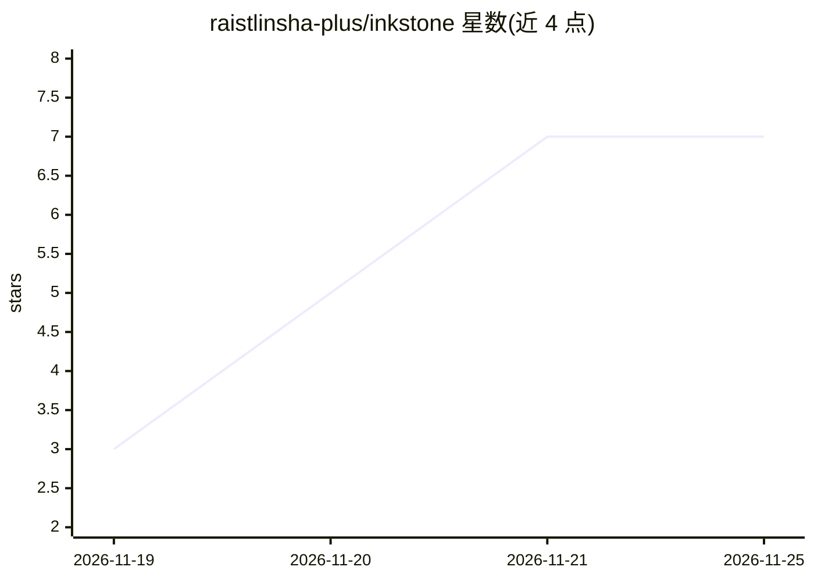

# raistlinsha-plus/inkstone

⭐ 7 · HTML · Apache-2.0 · 推送 2026-11-22 · [GitHub](https://github.com/raistlinsha-plus/inkstone) · [官网](https://raistlinsha-plus.github.io/inkstone/) · 个人维护 · 中文 README

**面向 macOS 用户的本地优先 Markdown 工作台，支持带引用的文档问答**

运行于 macOS 13+ Apple Silicon 的本地优先 Markdown 工作区：从多个文件夹导入 Markdown/TXT/JSON/Mermaid 文档，编辑与原始文件对比并导出；可选取文档生成 Wiki，对其中内容提问并打开指向原文段落的引用。检索机制包括关键词搜索、可选向量、可验证的 Wiki 引用与可选重排序；嵌入与重排序分别使用用户自行配置的端点（BYOK）。模型问答与 Wiki 整理时内容会发送到所配置的服务，密钥存于 macOS Keychain。界面为中文，需 Node/npm/Rust 工具链从源码构建。

## 筛选速览

| 维度 | 判定 | 备注 |
|---|---|---|
| AI 角色 | `ai-native` | 本体是模型或模型工具 |
| 许可风险 | `permissive` | Apache-2.0 |
| 部署形态 | `None` |  |
| 模型依赖 | — | README 未给出锁定关系 |
| 硬件要求 | — | 无带数字的原话,不猜 |
| 安装摩擦 | `low` | 无编译、无系统依赖或容器化 |
| 成熟度 | — | 结构信号不足 |

## 能力要点

- 问答引用可定位到原文段落并可保存为 Markdown 回到编辑行
- Wiki 生成前可审查变更与引用行，缺乏支持时可仅发布已验证摘录
- 本地存储文档、索引、对话与 Wiki 状态；密钥存于 macOS Keychain
- 三个像素角色伴伴停靠在页面边缘并可记录工作里程碑

## 适用场景

- 把分散在多个文件夹的项目笔记汇入一个本地工作区
- 写作时对文档提问并沿引用回到原文核对
- 由个人文档构建可审查的 Wiki 并保留可验证的摘录
- 无可用的模型密钥时用示例流程体验工作流

## 场景标签

`AI 助手` `文档问答` `知识库管理` `RAG` · 领域:对话与助手

## 证据(README 行号)

> L3: Inkstone is a local-first Markdown workspace for **macOS 13+ on Apple Silicon**. Bring in project notes from differe
> L14: - **Ask while writing.** Ask about one document, follow a citation to its source and return to your selection. For 
> L15: - **Review what your Wiki says.** Select the documents it may use. Inspect the proposed changes and their cited lin

## 星数曲线

2026-11-19 3 → 2026-11-25 7（+4）

---
*卡片 v1 · prompt 1.4 · 生成 2026-11-21 · 置信度 high · 依据 README sha `c4cc4c3ef0f6` · [字段定义](../../DATASET.md)*
