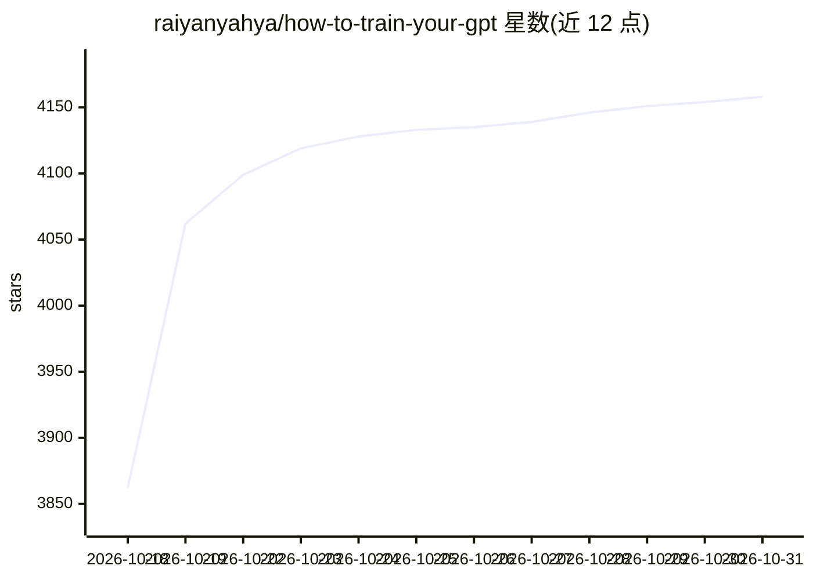

# raiyanyahya/how-to-train-your-gpt

⭐ 4,158 · Jupyter Notebook · MIT · 推送 2026-10-26 · [GitHub](https://github.com/raiyanyahya/how-to-train-your-gpt) · 个人维护

**面向零基础开发者的从零构建 GPT 交互式教科书（12 章）**

12 章、7,500+ 行的全注释交互式教材，教读者用 Python/PyTorch 从零实现 LLaMA 3 风格的 decoder-only Transformer（151M 参数、RoPE、RMSNorm、SwiGLU、pre-norm），覆盖 BPE 分词、注意力、训练循环与推理引擎。面向有 Python 基础但无 ML 经验的开发者与学生，每章配类比、数值算例、逐行注释代码与图解，另含 28 篇主题深入讲解和每章配套 Jupyter notebook，可在 Colab 运行，默认小模型 CPU 数分钟可训练，GPT-2 规模需 GPU。

## 筛选速览

| 维度 | 判定 | 备注 |
|---|---|---|
| AI 角色 | `ai-knowledge` | 知识聚合/清单类 |
| 许可风险 | `permissive` | MIT |
| 部署形态 | `library` | 以包/库形式分发 |
| 模型依赖 | — | README 未给出锁定关系 |
| 硬件要求 | — | 无带数字的原话,不猜 |
| 安装摩擦 | `low` | 无编译、无系统依赖或容器化 |
| 成熟度 | — | 结构信号不足 |

## 能力要点

- 从零实现 LLaMA 3 风格架构（RoPE/RMSNorm/SwiGLU/weight tying）
- 每行代码注释 WHAT 与 WHY，无 ML 背景要求
- 28 篇主题讲解（KV cache、Flash Attention、MoE、投机解码等）
- 提供 Colab notebook 与可运行 main.py（151M 参数模型）

## 适用场景

- 系统理解 Transformer 内部机制以读懂现代 ML 论文
- 动手写出分词器、注意力、训练与推理全流程
- 完成后的扩展实验（GQA、LoRA、RLHF/DPO）入门

## 场景标签

`教程课程` · 领域:学习与行业

## 证据(README 行号)

> L20: This is a **12-chapter, 7,500+ line interactive textbook** that teaches you how to build, train and run a modern la
> L24: You won't just read about Transformers. You'll **write every line yourself**: tokenizer, embeddings, attention, tra

## 星数曲线

2026-10-18 3,862 → 2026-10-31 4,158（+296）

---
*卡片 v1 · prompt 1.4 · 生成 2026-10-20 · 置信度 mid · 依据 README sha `41b2c83ee8e2` · [字段定义](../../DATASET.md)*
