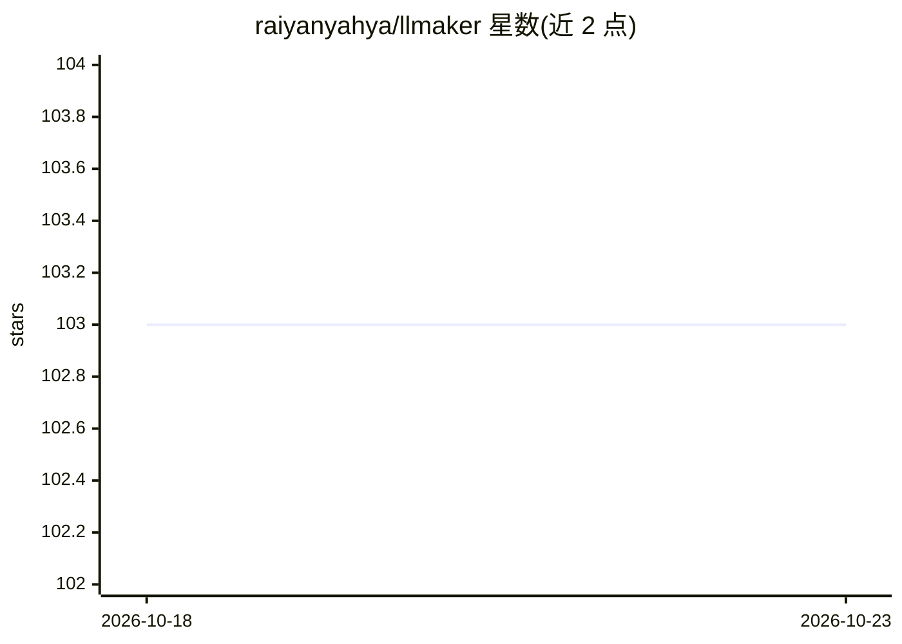

# raiyanyahya/llmaker

⭐ 103 · Go · NOASSERTION · 推送 2026-07-18 · [GitHub](https://github.com/raiyanyahya/llmaker) · [官网](https://llmaker.raiyanyahya.workers.dev/) · 个人维护

**自托管完整 LLM 技术栈的 CLI 供给与运维平台**

以单个 Go 静态二进制提供的开源平台，用于在自有基础设施上一条命令供给并运维完整 LLM 栈：模型、向量数据库（Qdrant/Chroma/pgvector/Weaviate）、embeddings、缓存、观测与内置检索/agent 层。栈以声明式 stack.yaml 定义并支持 apply --prune 协调；模型经 Ollama 运行并暴露 OpenAI 兼容 /v1/* API（llama.cpp 后端在开发中）。内置 FastAPI + LangGraph agent 服务，提供 rewrite→retrieve→rerank→generate 检索管线、工具调用、Langfuse 追踪与 LLM-as-judge 评测。运行需 Docker；提供 Linux/macOS 预编译二进制安装脚本，9 种栈模板。

## 筛选速览

| 维度 | 判定 | 备注 |
|---|---|---|
| AI 角色 | `ai-ecosystem` | LLM/agent 周边工具 |
| 许可风险 | `none` | NOASSERTION |
| 部署形态 | `self-host` | docker 或自建部署 |
| 模型依赖 | local-ok | 支持本地模型 |
| 硬件要求 | — | 无带数字的原话,不猜 |
| 安装摩擦 | `low` | 无编译、无系统依赖或容器化 |
| 成熟度 | `idea` | |

## 能力要点

- 一条命令供给模型+向量库+缓存+观测的完整栈，声明式可协调
- 内置 FastAPI + LangGraph agent：RAG 管线、工具调用、Langfuse 追踪、评测 API
- 模型暴露 OpenAI 兼容 /v1/* API，Ollama 运行、llama.cpp 后端开发中
- 容器默认绑定 127.0.0.1，私有网络内按名发现，GPU 独占分区

## 适用场景

- 本地搭建私有 RAG 问答/FAQ 助手而无需手写 Compose
- 以统一 CLI 运维一批模型与服务的舰队：状态、日志、资源面板
- 给本地模型暴露 OpenAI 兼容端点供现有客户端调用

## 场景标签

`RAG` `Agent 框架` `推理引擎` `LLM 可观测性` · 领域:Agent 开发

## 证据(README 行号)

> L43: llmaker removes that tax. One CLI provisions the entire stack on a private network
> L72: |**OpenAI-compatible**|Each model exposes a stable `/v1/*` API (chat, completions, embeddings, streaming) behind on

## 星数曲线

2026-10-18 103 → 2026-10-23 103（+0）

---
*卡片 v1 · prompt 1.4 · 生成 2026-10-23 · 置信度 mid · 依据 README sha `12e411225e6a` · [字段定义](../../DATASET.md)*
