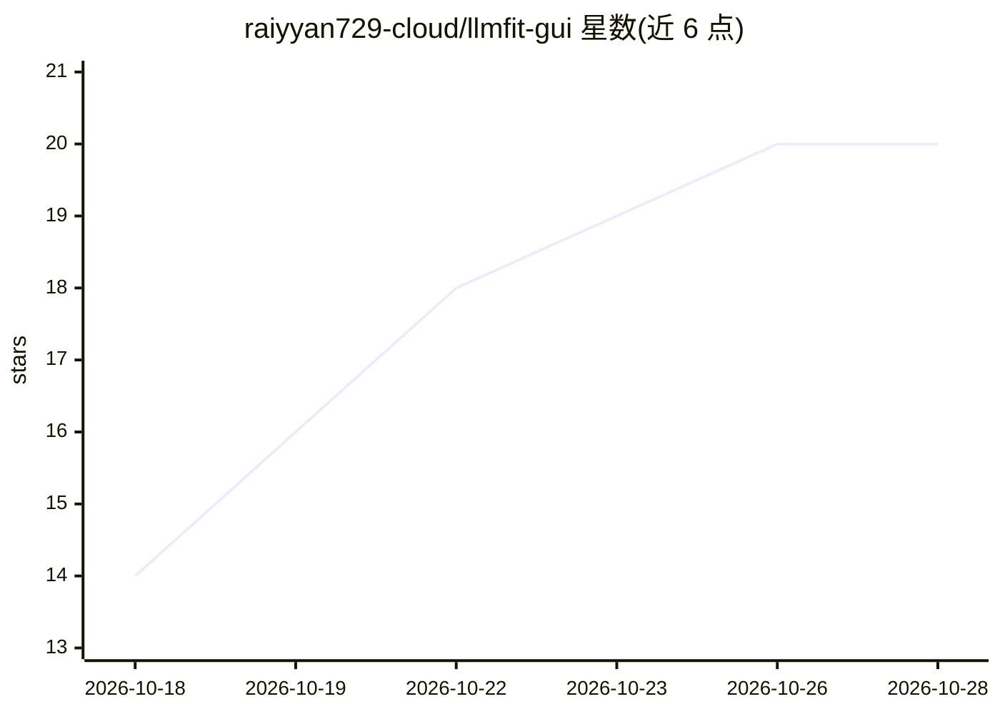

# raiyyan729-cloud/llmfit-gui

⭐ 20 · PowerShell · 推送 2026-09-02 · [GitHub](https://github.com/raiyyan729-cloud/llmfit-gui) · [官网](https://github.com/AlexsJones/llmfit) · 个人维护

**Windows GUI，按硬件选型、下载并基准测试本地 LLM**

PowerShell + WinForms 编写的 Windows 桌面应用，封装 llmfit CLI：根据本机 GPU/CPU/RAM 推荐合适尺寸的模型，从 Hugging Face 查询实际可用的量化版本与文件大小，可将模型直接下载到 LM Studio 或 Ollama 或保存为 GGUF 文件，并对已下载模型做 tokens/sec 基准测试（可自动启动 LM Studio 本地服务器）。运行需要 llmfit CLI 在 PATH 上，下载与基准功能需 LM Studio 或 Ollama。项目自述为 Beta，处于活跃开发期，可能出现破坏性变更。

## 筛选速览

| 维度 | 判定 | 备注 |
|---|---|---|
| AI 角色 | `ai-ecosystem` | LLM/agent 周边工具 |
| 许可风险 | `none` | — |
| 部署形态 | `library` | 以包/库形式分发 |
| 模型依赖 | local-ok | 支持本地模型 |
| 硬件要求 | — | 无带数字的原话,不猜 |
| 安装摩擦 | `low` | 无编译、无系统依赖或容器化 |
| 成熟度 | `idea` | |

## 能力要点

- 按 GPU/CPU/RAM 推荐模型并展示可排序结果网格
- 从 Hugging Face 查询实际量化版本与文件大小
- 直接下载到 LM Studio 或 Ollama，或保存为 GGUF 文件
- 本机 tokens/sec 基准测试，可自动启动 LM Studio 本地服务器

## 适用场景

- 不确定自己硬件能跑哪个本地模型时做选型
- 把适配的模型直接下载进 LM Studio 或 Ollama
- 在本机实测已下载模型的 tokens/sec 性能

## 场景标签

`模型评测` · 领域:评测与运维

## 证据(README 行号)

> L7: A Windows desktop app (PowerShell + WinForms) that wraps the `llmfit` CLI to help you find, download, and benchmark 
> L12: - Downloads models directly into **LM Studio** or **Ollama**, or as a raw GGUF file.

## 星数曲线

2026-10-18 14 → 2026-10-28 20（+6）

---
*卡片 v1 · prompt 1.4 · 生成 2026-10-28 · 置信度 mid · 依据 README sha `c790f1e1a8f5` · [字段定义](../../DATASET.md)*
