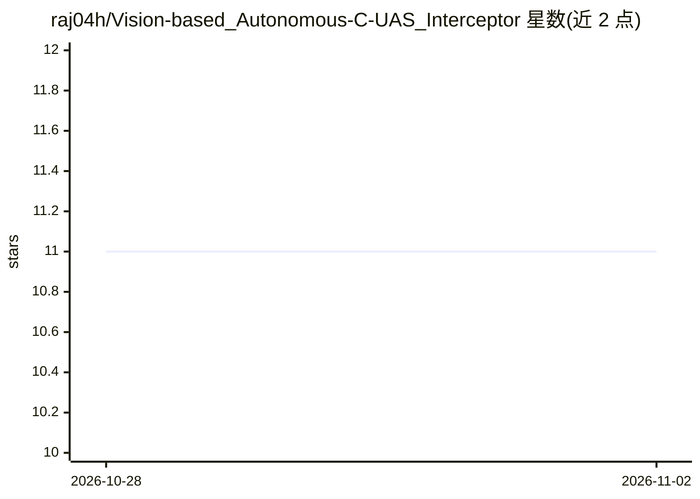

# raj04h/Vision-based_Autonomous-C-UAS_Interceptor

⭐ 11 · Python · NOASSERTION · 推送 2026-09-02 · [GitHub](https://github.com/raj04h/Vision-based_Autonomous-C-UAS_Interceptor) · [官网](https://deepwiki.com/raj04h/Vision-Based-Autonomous-Counter-Drone-System) · 个人维护

**视觉自主反无人机的拦截无人机系统：检测、跟踪并追捕空中目标**

基于 ROS2 Humble 的视觉制导自主拦截系统：YOLO 检测 + DeepSORT 跟踪 + Kalman 滤波估计目标运动并预测未来位置，图像空间生成制导指令，经 PX4 Offboard 接口闭环控制飞行；配套自研 Gazebo 空对空仿真环境（脚本化固定翼目标轨迹、FPV 相机）做确定性可重复测试，FastAPI + PostgreSQL 后端与 Plotly Dash 实时监控面板。V1 限于 2D 图像空间测量、仿真 PX4 飞控与 CPU 推理，实际拦截需 3D 定位与实机验证。

## 筛选速览

| 维度 | 判定 | 备注 |
|---|---|---|
| AI 角色 | `ai-native` | 本体是模型或模型工具 |
| 许可风险 | `none` | NOASSERTION |
| 部署形态 | `desktop` | 安装包/桌面程序 |
| 模型依赖 | — | README 未给出锁定关系 |
| 硬件要求 | `cpu-ok` | |
| 安装摩擦 | `low` | 无编译、无系统依赖或容器化 |
| 成熟度 | — | 结构信号不足 |

## 能力要点

- YOLO + DeepSORT + Kalman 滤波的检测/跟踪/状态估计链路
- PX4 Offboard 闭环飞行控制与 SEARCH→TRACK→LOCK 状态转换
- 确定性 Gazebo 空对空仿真环境与 FPV 相机
- FastAPI + PostgreSQL 遥测存储与 Plotly Dash 实时面板

## 适用场景

- 在仿真中复现反无人机目标检测、跟踪与追击全流程
- 研究 RF 静默/GPS 拒止环境下的视觉自主拦截架构
- 验证感知到飞控的端到端自主管线并监控遥测数据

## 场景标签

 · 领域:机器人/无人机自主系统

## 证据(README 行号)

> L3: Counter-UAS Autonomous Interceptor is a ROS2-based vision-guided autonomous interception system capable of detecting
> L59: The system combines YOLO-based object detection, DeepSORT tracking, Kalman Filter state estimation, target-motion p
> L115: - Detect aerial targets from video

## 星数曲线

2026-10-28 11 → 2026-11-02 11（+0）

---
*卡片 v1 · prompt 1.4 · 生成 2026-11-02 · 置信度 high · 依据 README sha `4b45fb399ded` · [字段定义](../../DATASET.md)*
