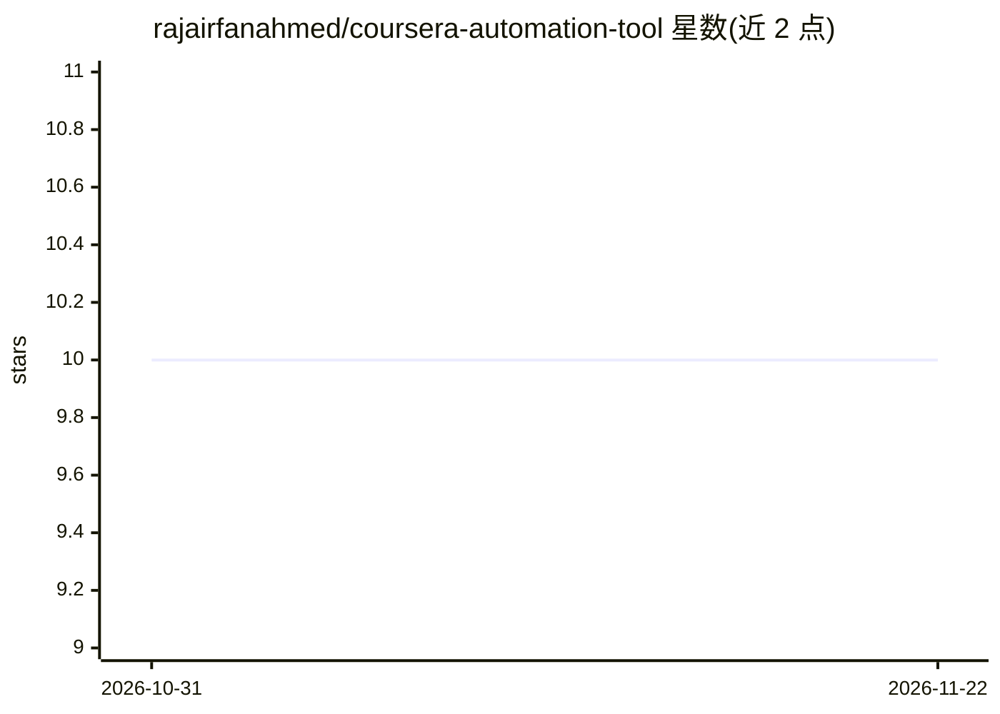

# rajairfanahmed/coursera-automation-tool

⭐ 10 · JavaScript · MIT · 推送 2026-04-24 · [GitHub](https://github.com/rajairfanahmed/coursera-automation-tool) · 个人维护

**自动播放视频、完成阅读并用 Claude/ChatGPT 解答 Coursera 测验的 Chrome 扩展**

Chrome 扩展（Manifest V3），为 Coursera 用户提供一键式课程自动化：自动播放视频（0.5×–4× 变速）、自动完成阅读材料、自动跳过倒计时与荣誉承诺勾选。测验部分通过 content script 注入 claude.ai / chatgpt.com 页面，复用浏览器已有登录会话（无需 API key）向 AI 提问并回填答案，支持手动模式（仅填答案不提交）与主备引擎自动回退。支持测验/考试/作业提交页，自动跳过互评作业。安装方式为下载仓库后在 Chrome 开发者模式加载。

## 筛选速览

| 维度 | 判定 | 备注 |
|---|---|---|
| AI 角色 | `ai-enhanced` | 去掉 AI 部分产品仍成立 |
| 许可风险 | `permissive` | MIT |
| 部署形态 | `None` |  |
| 模型依赖 | — | README 未给出锁定关系 |
| 硬件要求 | — | 无带数字的原话,不猜 |
| 安装摩擦 | `low` | 无编译、无系统依赖或容器化 |
| 成熟度 | — | 结构信号不足 |

## 能力要点

- 一键 autopilot 自动完成视频、阅读与测验
- 通过 claude.ai / chatgpt.com 页面桥接复用已有会话，无需 API key
- Claude 与 ChatGPT 双引擎可切换，失败时自动回退
- 手动模式支持先审阅 AI 答案再自行提交

## 适用场景

- 自动完成 Coursera 课程的视频与阅读部分
- 对测验题目获取 AI 答案并人工审阅后提交
- 以可配置倍速播放课程视频

## 场景标签

`浏览器自动化` · 领域:效率与自动化

## 证据(README 行号)

> L16: - **One-click autopilot** — starts from your current position and completes videos, readings, and quizzes automatic
> L19: - **Quiz auto-solving** — uses AI (Claude or ChatGPT) to answer quizzes and auto-submits
> L26: - **Claude & ChatGPT bridge scripts** — seamlessly communicates with AI tabs via Chrome storage messaging

## 星数曲线

2026-10-31 10 → 2026-11-22 10（+0）

---
*卡片 v1 · prompt 1.4 · 生成 2026-11-19 · 置信度 high · 依据 README sha `41d5a55074aa` · [字段定义](../../DATASET.md)*
