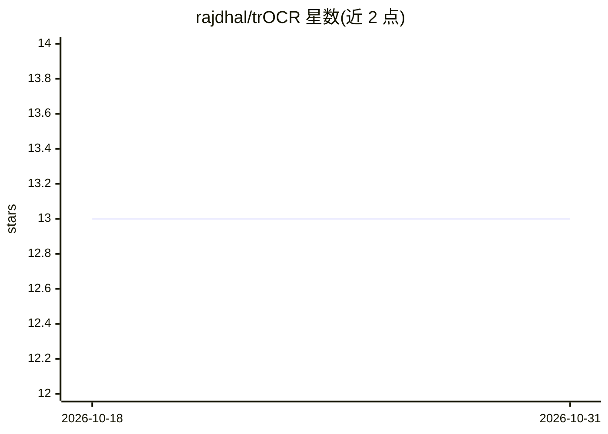

# rajdhal/trOCR

⭐ 13 · Python · 推送 2026-02-01 · [GitHub](https://github.com/rajdhal/trOCR) · [官网](https://ai.rajand.xyz/) · 组织维护

**温莎大学签到表姓名识别：trOCR+YOLO 的手写文本识别应用**

面向温莎大学 SmartCampus 项目的开源应用：基于定制版 Microsoft trOCR 与 YOLOv8 对象检测，从表单/文档图像中定位并识别手写文本，输出标注图像与可下载 CSV。通过 Gradio 提供 Web 界面，运行后浏览器访问 localhost:7860 上传图片即可使用。属高校课程/校园项目（4990/4960），需 Python 3.10+，从源码克隆安装，代码可按需定制模型与界面。

## 筛选速览

| 维度 | 判定 | 备注 |
|---|---|---|
| AI 角色 | `ai-native` | 本体是模型或模型工具 |
| 许可风险 | `none` | — |
| 部署形态 | `library` | 以包/库形式分发 |
| 模型依赖 | — | README 未给出锁定关系 |
| 硬件要求 | — | 无带数字的原话,不猜 |
| 安装摩擦 | `low` | 无编译、无系统依赖或容器化 |
| 成熟度 | — | 结构信号不足 |

## 能力要点

- 定制版 Microsoft trOCR 手写文本识别
- YOLOv8 对象检测用于图像分析与文本定位
- Gradio Web 界面，输出标注图像与 CSV 文件
- 可定制模型与界面适配具体用例

## 适用场景

- 自动识别纸质签到表上的手写姓名
- 批量处理表单/文档图像并导出 CSV
- 在此基础上定制自己的 OCR 识别流程

## 场景标签

`OCR` `目标检测` · 领域:感知与多模态

## 证据(README 行号)

> L3: Welcome to the University of Windsor's SmartCampus Text Recognition project! This open-source repository is dedicate
> L7: - Seamlessly integrated with our custom trOCR technology.

## 星数曲线

2026-10-18 13 → 2026-10-31 13（+0）

---
*卡片 v1 · prompt 1.4 · 生成 2026-10-31 · 置信度 mid · 依据 README sha `42569e5fb157` · [字段定义](../../DATASET.md)*
