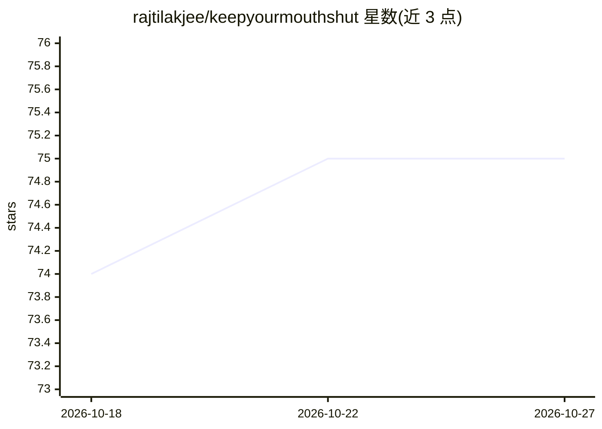

# rajtilakjee/keepyourmouthshut

⭐ 75 · Python · GPL-3.0 · 推送 2026-06-13 · [GitHub](https://github.com/rajtilakjee/keepyourmouthshut) · 个人维护

**面向开发者的 AI 播客生成应用：输入主题产出脚本与配音**

基于 Flask 的开源播客生成应用：终端用户提交若干输入后，应用调用 LLM 生成播客脚本，再经 TTS 引擎产出语音配音文件，附带 Pixabay 免版税背景音乐，无需专业录音设备。默认 LLM 为 llmOS（Mistral-7B），默认 TTS 为 edge-tts（en-GB-SoniaNeural），本 fork 另加入 60db 作为 TTS/LLM/STT 的可选 peer 提供方，通过 .env 开关切换。本地运行需安装 FFMPEG、配置 llmOS API key 并以 pip 安装依赖后启动 Flask 应用。

## 筛选速览

| 维度 | 判定 | 备注 |
|---|---|---|
| AI 角色 | `ai-native` | 本体是模型或模型工具 |
| 许可风险 | `viral` | GPL-3.0 |
| 部署形态 | `library` | 以包/库形式分发 |
| 模型依赖 | — | README 未给出锁定关系 |
| 硬件要求 | — | 无带数字的原话,不猜 |
| 安装摩擦 | `medium` | 含编译或系统依赖之一 |
| 成熟度 | — | 结构信号不足 |

## 能力要点

- 根据用户输入生成播客脚本与语音配音文件
- 默认 llmOS（Mistral-7B）+ edge-tts 流水线
- 60db 可选 peer 提供方，覆盖 TTS/LLM/STT，开关独立可混用
- 内置 Pixabay 免版税背景音乐，可部署到 AWS/Zappa

## 适用场景

- 无录音设备的情况下生成完整播客节目
- 开发者以本地 Flask 应用方式运行并自定义 LLM/TTS 提供方
- 将播客生成流程部署为 AWS 服务或 Serverless 函数

## 场景标签

`语音合成` `AI 写作` · 领域:内容生成

## 证据(README 行号)

> L7: KeepYourMouthShut is an AI-assisted open-source app that provides a 360-degree podcast solution 🎙️ It has a develope
> L38: - llmOS — default LLM (Mistral-7B)
> L39: - edge-tts — default TTS (`en-GB-SoniaNeural`)

## 星数曲线

2026-10-18 74 → 2026-10-27 75（+1）

---
*卡片 v1 · prompt 1.4 · 生成 2026-10-24 · 置信度 high · 依据 README sha `85fb7b935b1a` · [字段定义](../../DATASET.md)*
