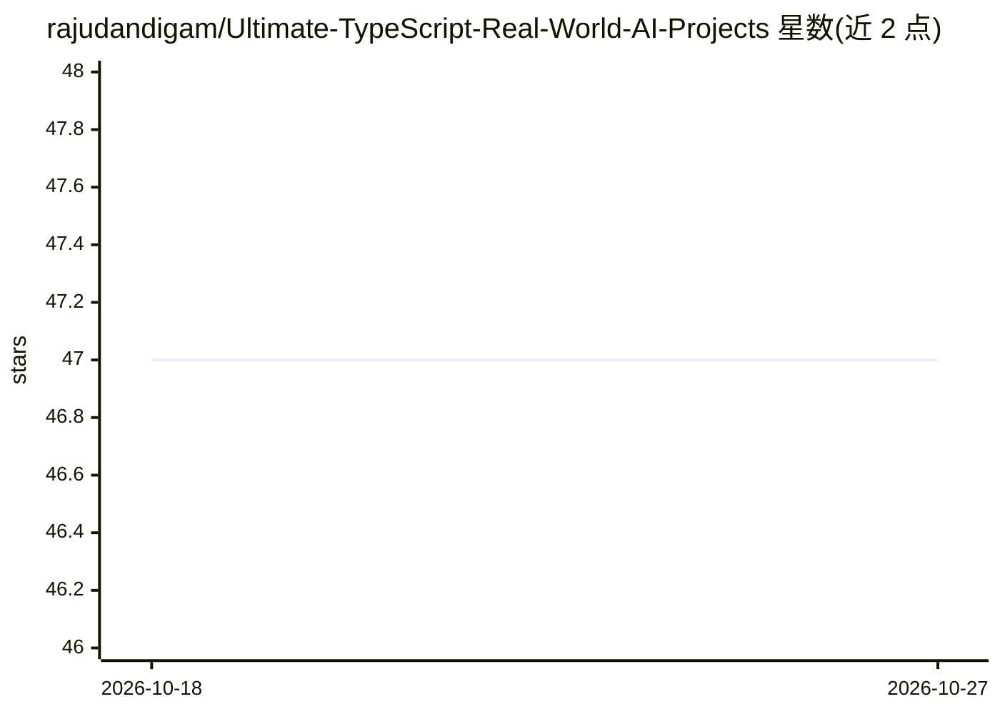

# rajudandigam/Ultimate-TypeScript-Real-World-AI-Projects

⭐ 47 · TypeScript · 推送 2026-05-04 · [GitHub](https://github.com/rajudandigam/Ultimate-TypeScript-Real-World-AI-Projects) · [官网](https://github.com/rajudandigam/Ultimate-TypeScript-Real-World-AI-Projects) · 个人维护

**263 个 TypeScript AI 系统蓝图目录：工作流/Agent/多智能体**

以文档目录为主体：263 个 AI 系统蓝图（77 个工作流、144 个 Agent、32 个多智能体、10 个 Agentic UI），每条含 README 与 architecture.md，覆盖问题、技术栈、评估、失败模式与扩展。附带生产参考层：少量可运行的 reference-implementations（如 AI 成本监控引擎）、共享包（@repo/core/governance/evals）、基准测试与 CI 质量门。面向从 prompt/demo 阶段进阶到生产系统的 TypeScript 工程师。

## 筛选速览

| 维度 | 判定 | 备注 |
|---|---|---|
| AI 角色 | `ai-knowledge` | 知识聚合/清单类 |
| 许可风险 | `none` | — |
| 部署形态 | `library` | 以包/库形式分发 |
| 模型依赖 | — | README 未给出锁定关系 |
| 硬件要求 | — | 无带数字的原话,不猜 |
| 安装摩擦 | `low` | 无编译、无系统依赖或容器化 |
| 成熟度 | — | 结构信号不足 |

## 能力要点

- 263 个蓝图按领域与复杂度 L1-L5 组织
- 部分蓝图提供 clone-and-run 参考实现与共享 TypeScript 包
- pnpm workspace 含 typecheck/test/benchmark CI 质量门

## 适用场景

- 挑选并研读某个领域的 AI 系统架构方案
- 从工作流/Agent/多智能体路径系统学习生产级设计
- 以参考实现为起点搭建自己的 AI 成本监控等系统

## 场景标签

`教程课程` · 领域:学习与行业

## 证据(README 行号)

> L5: **263 blueprint-grade workflows, agents, and multi-agent systems — TypeScript-first.** The **Project catalog** is do
> L18: - **Blueprint catalog** — **263** AI system blueprints under `projects/`, each with `README.md` and `architecture.m
> L46: **263** project ideas, each with **`README.md`** + **`architecture.md`** under `projects/`. The catalog tables belo

## 星数曲线

2026-10-18 47 → 2026-10-27 47（+0）

---
*卡片 v1 · prompt 1.4 · 生成 2026-10-25 · 置信度 high · 依据 README sha `ada1a1c82795` · [字段定义](../../DATASET.md)*
