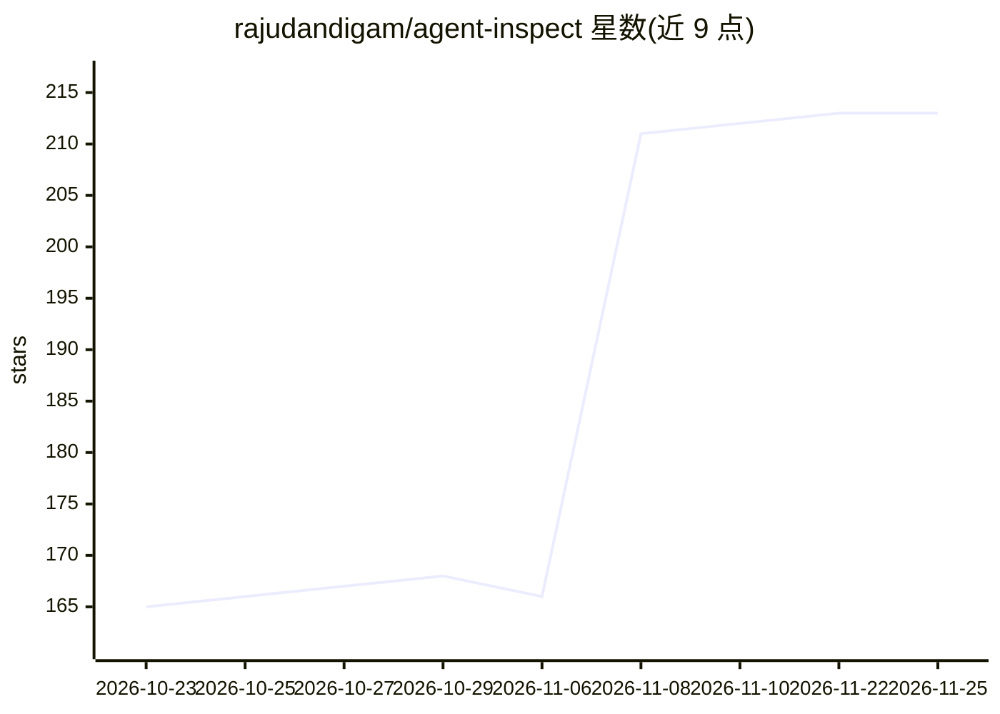

# rajudandigam/agent-inspect

⭐ 213 · TypeScript · MIT · 推送 2026-11-24 · [GitHub](https://github.com/rajudandigam/agent-inspect) · [官网](https://agentinspect.vercel.app) · 个人维护

**TypeScript AI agent 的本地证据调试与轨迹测试 CLI 工具**

面向 TypeScript agent 开发者的本地优先工具链：将 agent 运行记录捕获为本地 JSONL，生成可读执行树（嵌套步骤、工具调用、LLM 调用、token 元数据、错误）与确定性轨迹检查，可在 CI 中按预设规则（如必需工具、调用顺序）失败退出；支持生成脱敏、哈希可校验的 Evidence v2 离线证据包。无账户、无采集器、默认不上传，捕获默认仅元数据。提供 npm 包（18 包固定发布组）含 LangChain/LangGraph、AI SDK、OpenAI Agents JS 适配器及 Vitest/Jest reporter，需 Node.js 20+。

## 筛选速览

| 维度 | 判定 | 备注 |
|---|---|---|
| AI 角色 | `ai-ecosystem` | LLM/agent 周边工具 |
| 许可风险 | `permissive` | MIT |
| 部署形态 | `library` | 以包/库形式分发 |
| 模型依赖 | — | README 未给出锁定关系 |
| 硬件要求 | — | 无带数字的原话,不猜 |
| 安装摩擦 | `low` | 无编译、无系统依赖或容器化 |
| 成熟度 | — | 结构信号不足 |

## 能力要点

- 将 agent 运行转为可读执行树与本地 JSONL 追踪
- 确定性、无 provider 依赖的轨迹检查，可在 CI 中以退出码失败
- 生成脱敏且离线哈希校验的 Evidence v2 证据包
- 提供 LangChain/LangGraph、AI SDK、OpenAI Agents JS 等框架适配器与 Vitest/Jest reporter

## 适用场景

- 在本地读取 agent 运行的因果路径并定位首个失败点
- 在 CI 中拦截调错工具或顺序的 agent 回归
- 为 PR/事故报告附带脱敏、可校验的离线运行证据
- 复用已有结构化日志或 OpenInference/OTLP JSON 生成执行树

## 场景标签

`LLM 可观测性` · 领域:评测与运维

## 证据(README 行号)

> L10:  AgentInspect turns TypeScript agent runs into readable execution trees,
> L53: ### Prevent — fail CI on the wrong trajectory
> L67: A passing check exits `0`; a rule failure exits `1`. Invalid configuration and unreadable/unsupported inputs use se

## 星数曲线

2026-10-23 165 → 2026-11-25 213（+48）

---
*卡片 v1 · prompt 1.4 · 生成 2026-11-25 · 置信度 high · 依据 README sha `e3235356c5c5` · [字段定义](../../DATASET.md)*
