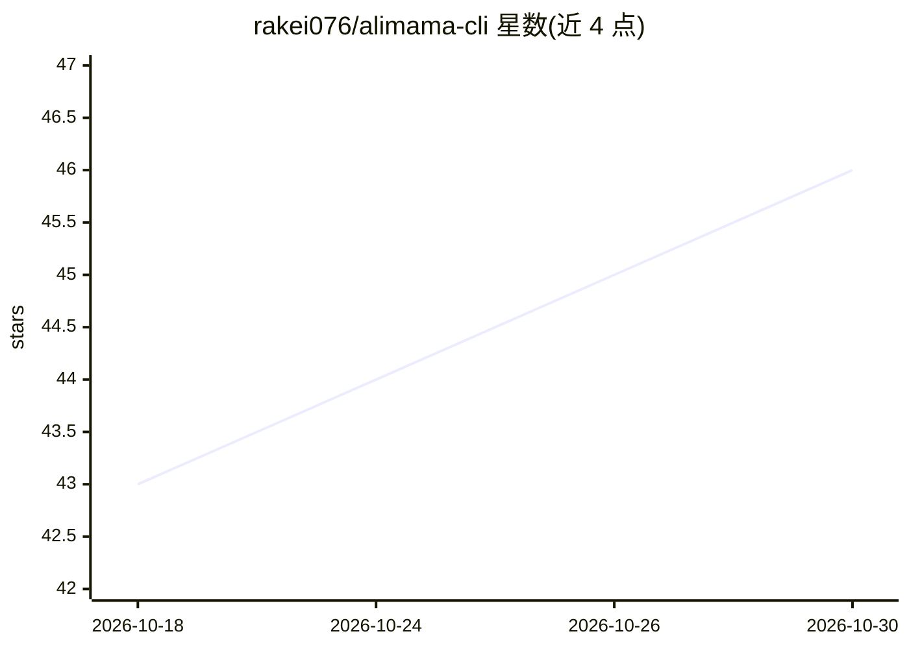

# rakei076/alimama-cli

⭐ 46 · Python · MIT · 推送 2026-10-20 · [GitHub](https://github.com/rakei076/alimama-cli) · 个人维护 · 中文 README

**读取万相台广告数据的只读 CLI + MCP Skill，供 AI 助手查广告花费**

运行在本机的只读工具：通过用户在 Chrome 中已登录的万相台（阿里妈妈）账号，读取花费、投产及计划、单元、关键词、人群、商品等报表，以命令行和 MCP 两种方式供 AI 助手调用，并可作为 Skill 放入 Claude Code 目录。无任何写操作，名称像写操作的接口一律拒绝；通过随机请求间隔、200 请求提醒与风控词停止做风控控制。Windows 需安装取数桥插件，Mac 可直接读取登录状态；另可自动下载启用生意参谋等同套工具模块。

## 筛选速览

| 维度 | 判定 | 备注 |
|---|---|---|
| AI 角色 | `ai-ecosystem` | LLM/agent 周边工具 |
| 许可风险 | `permissive` | MIT |
| 部署形态 | `None` |  |
| 模型依赖 | — | README 未给出锁定关系 |
| 硬件要求 | — | 无带数字的原话,不猜 |
| 安装摩擦 | `low` | 无编译、无系统依赖或容器化 |
| 成熟度 | — | 结构信号不足 |

## 能力要点

- 只读访问，无任何广告改动功能
- MCP 接入 Claude Code / Codex / Cursor / Claude Desktop
- 按计划/单元/关键词/人群/商品拆分的花费与投产报表
- 随机请求间隔、风控词检测与请求上限等风控措施

## 适用场景

- 问 AI 助手昨天广告花了多少、哪些计划在亏
- 按关键词、人群、商品维度拆分查看广告花费构成
- 店铺经营者自查万相台广告数据

## 场景标签

`数据分析` · 领域:效率与自动化

## 证据(README 行号)

> L29: 5. **接入 AI 助手**：运行 `scripts/alimama.sh mcp install`（Windows：`scripts\alimama.cmd mcp install`），将本工具通过 MCP 接入电脑上的 AI
> L8: alimama-cli 是一款读取万相台（阿里妈妈）广告数据的工具，可帮助你和 AI 助手查看花费、投产，以及计划、单元、关键词、人群和商品报表，看清广告费用花在哪里、哪些花费在浪费。工具在你的电脑上运行，使用你在 Chrome 中

## 星数曲线

2026-10-18 43 → 2026-10-30 46（+3）

---
*卡片 v1 · prompt 1.4 · 生成 2026-10-25 · 置信度 high · 依据 README sha `735d80ba8569` · [字段定义](../../DATASET.md)*
