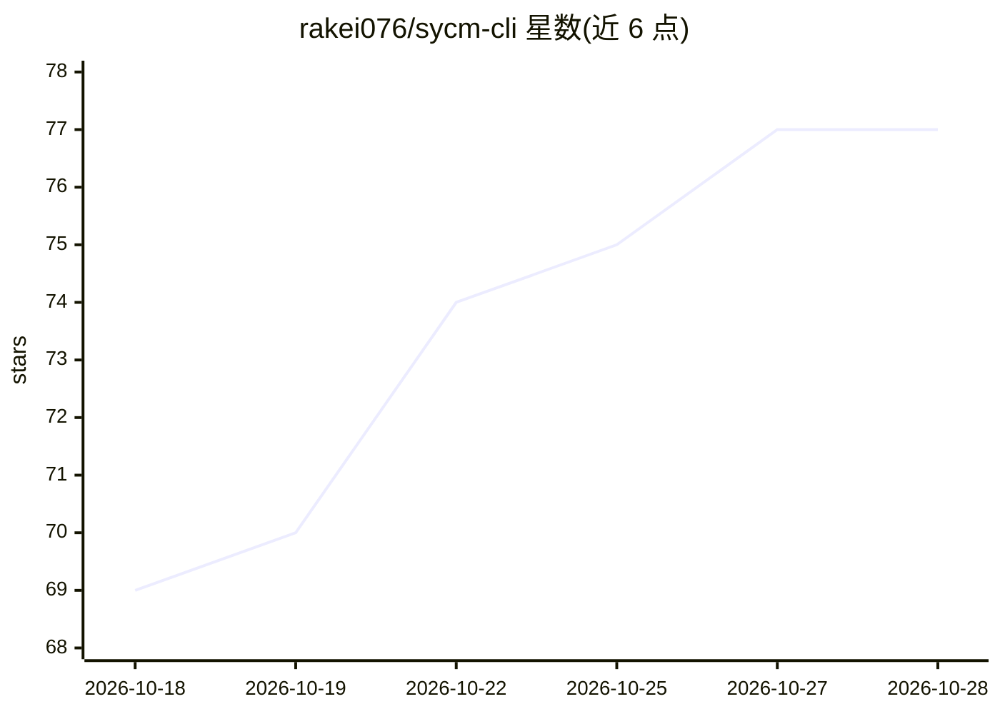

# rakei076/sycm-cli

⭐ 77 · Python · MIT · 推送 2026-10-20 · [GitHub](https://github.com/rakei076/sycm-cli) · 个人维护 · 中文 README

**生意参谋只读取数 CLI，配合 AI 助手做店铺经营分析**

在本机运行的生意参谋（sycm.taobao.com）只读数据工具：复用 Chrome 中已登录的账号（Windows 需安装取数桥插件）读取首页大盘、商品、交易退款、客服对话等数据，提供 60 余个 CLI 命令，并通过 MCP 接入 Claude Code、Codex、Cursor、Claude Desktop 等 AI 客户端，由 AI 助手完成日检、周复盘、单品诊断报告（七页网页）、测款、退货归因与客服质检。内置请求间隔与风控词检测，仅读取不写入。

## 筛选速览

| 维度 | 判定 | 备注 |
|---|---|---|
| AI 角色 | `ai-ecosystem` | LLM/agent 周边工具 |
| 许可风险 | `permissive` | MIT |
| 部署形态 | `None` |  |
| 模型依赖 | locked-api |  |
| 硬件要求 | — | 无带数字的原话,不猜 |
| 安装摩擦 | `low` | 无编译、无系统依赖或容器化 |
| 成熟度 | — | 结构信号不足 |

## 能力要点

- 复用 Chrome 已登录账号只读生意参谋数据，不做任何写操作
- MCP 接入 Claude Code / Codex / Cursor / Claude Desktop
- 生成七页单品诊断网页报告（可脱敏、可每周跟踪复盘）
- 请求间隔 1.8~3.5 秒、风控词出现即停止的安全机制

## 适用场景

- 让 AI 助手每天查看店铺大盘并提示异常
- 生成单品诊断报告并按周复盘执行方案
- 分析退货原因和客服回复质量

## 场景标签

`数据分析` `网页抓取` · 领域:效率与自动化

## 证据(README 行号)

> L8: sycm-cli 是一款读取生意参谋店铺数据的工具，可帮助你和 AI 助手查看首页大盘、商品、交易退款和客服对话等经营数据，并完成日检、周复盘、单品诊断、测款和退货归因。工具在你的电脑上运行，使用你在 Chrome 中已登录的生意参
> L29: 5. **接入 AI 助手**：运行 `scripts/sycm.sh mcp install`（Windows：`scripts\sycm.cmd mcp install`），通过 MCP 把本工具接入电脑上的 Claude C

## 星数曲线

2026-10-18 69 → 2026-10-28 77（+8）

---
*卡片 v1 · prompt 1.4 · 生成 2026-10-24 · 置信度 high · 依据 README sha `84b87406d363` · [字段定义](../../DATASET.md)*
