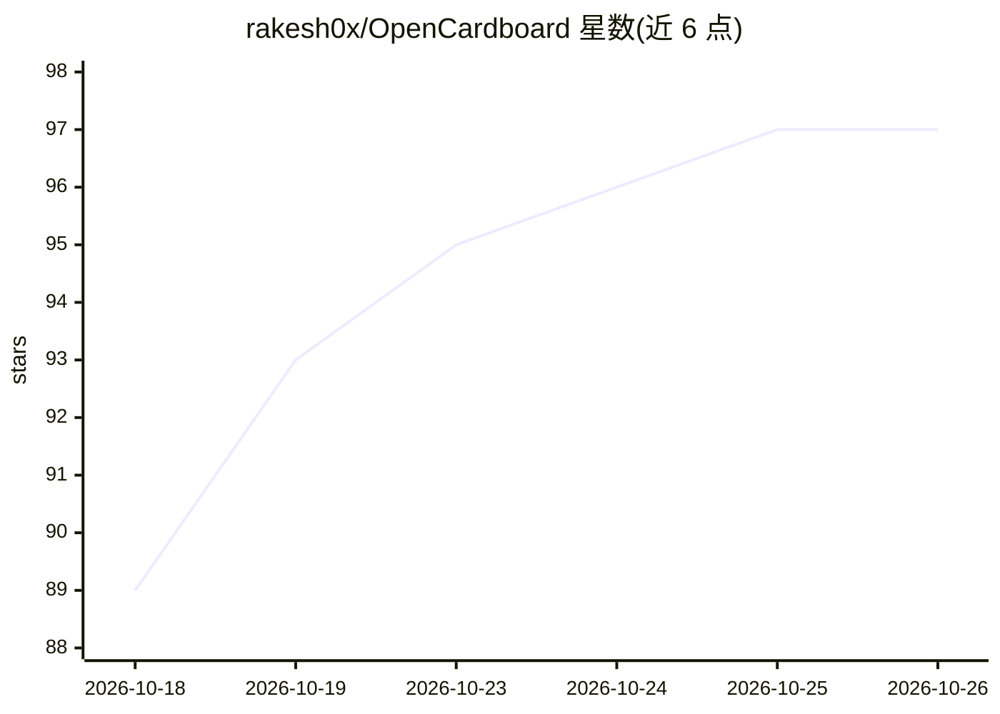

# rakesh0x/OpenCardboard

⭐ 97 · TypeScript · MIT · 推送 2026-10-04 · [GitHub](https://github.com/rakesh0x/OpenCardboard) · 个人维护

**本地优先的对话式 AI 视频剪辑桌面应用**

基于 Electron + React + ffmpeg 的开源视频剪辑器：用户导入原始素材后，通过内置聊天或任意 MCP 客户端（Claude Code、Cursor 等）以自然语言驱动剪辑——本地 whisper.cpp 转写、场景检测、静音剪除、字幕、节拍同步剪切、动效合成与导出。转写等 AI 分析在本机运行（whisper.cpp/ffmpeg/本地 ONNX），云端模型按能力可选开启。所有剪辑操作记录在 append-only 操作日志中，支持撤销/重做与崩溃恢复，另内置仅回环的本地 MCP 服务器供外部 agent 无头编辑。素材文件不离开本机。

## 筛选速览

| 维度 | 判定 | 备注 |
|---|---|---|
| AI 角色 | `ai-native` | 本体是模型或模型工具 |
| 许可风险 | `permissive` | MIT |
| 部署形态 | `library` | 以包/库形式分发 |
| 模型依赖 | local-ok | 支持本地模型 |
| 硬件要求 | — | 无带数字的原话,不猜 |
| 安装摩擦 | `medium` | 含编译或系统依赖之一 |
| 成熟度 | — | 结构信号不足 |

## 能力要点

- 本地运行的转写（whisper.cpp）、场景检测与节拍检测，云端模型按能力可选
- 30+ 类型化工具集，内置聊天与 MCP 客户端共用同一操作日志，支持撤销与无头编辑
- 仅回环且带 bearer token 的本地 MCP 服务器（npx cutboard-mcp 提供 stdio 桥）
- 硬件编码导出（VideoToolbox/NVENC/QSV/AMF）与 OTIO 交接至 Resolve/Premiere/FCP

## 适用场景

- 用对话描述剪辑意图，让 agent 在真实时间线上完成粗剪、字幕与节拍同步
- 不让素材离开本机的前提下完成含转写与字幕的短视频制作
- 通过 MCP 让 Claude Code/Cursor 等外部 agent 无头驱动剪辑项目

## 场景标签

`视频生成` · 领域:内容生成

## 证据(README 行号)

> L23: - **Local-first.** Originals stay where they are. Transcription, scene detection, and beat
> L24:  detection run on your machine (whisper.cpp, ffmpeg, local ONNX). Cloud models are
> L36: |**Footage understanding**|Word-level transcript (whisper.cpp), scene detection with keyframes, optional VLM scene 

## 星数曲线

2026-10-18 89 → 2026-10-26 97（+8）

---
*卡片 v1 · prompt 1.4 · 生成 2026-10-23 · 置信度 mid · 依据 README sha `67ac5b64c36d` · [字段定义](../../DATASET.md)*
