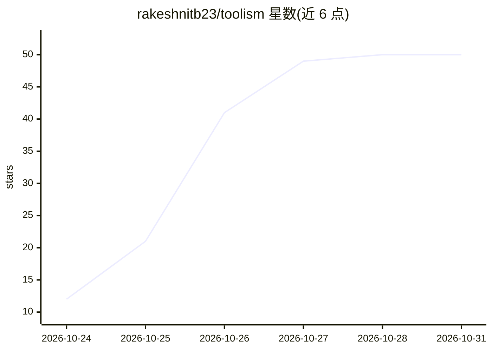

# rakeshnitb23/toolism

⭐ 50 · Python · MIT · 推送 2026-10-30 · [GitHub](https://github.com/rakeshnitb23/toolism) · 个人维护

**测量并安全削减 LLM 工具/MCP schema 的 token 成本**

面向构建 LLM agent 的开发者：工具定义（OpenAI function、Anthropic tool、MCP server tool）随每次请求发送并计费，toolism 测量其 token 成本，通过 11 条确定性规则削减 JSON Schema 冗余（重复 title、anyOf 包装、unused $defs 等），默认 safe 级别保证验证等价（接受相同工具调用），可选 hypothesis-jsonschema 双向等价验证并在发现反例时回滚。提供 CLI、Python API、GitHub Action 与 pre-commit 钩子，基于基线的 CI 门禁阻止 token 回涨。基准为 14 个工具集平均削减 37.4%。

## 筛选速览

| 维度 | 判定 | 备注 |
|---|---|---|
| AI 角色 | `ai-ecosystem` | LLM/agent 周边工具 |
| 许可风险 | `permissive` | MIT |
| 部署形态 | `library` | 以包/库形式分发 |
| 模型依赖 | locked-api |  |
| 硬件要求 | — | 无带数字的原话,不猜 |
| 安装摩擦 | `low` | 无编译、无系统依赖或容器化 |
| 成熟度 | `idea` | |

## 能力要点

- 11 条确定性削减规则，默认 safe 级别保证验证等价
- hypothesis-jsonschema 双向等价验证，反例时自动回滚
- CLI / Python API / GitHub Action / pre-commit 四种使用形式
- 支持三种 token 计数器：tiktoken、离线 heuristic、Anthropic 精确计数

## 适用场景

- agent 项目里削减每次请求携带的工具定义 token 开销
- 在 CI 中用基线门禁防止工具 schema token 回涨
- 接入 MCP server 前测量并优化其工具定义成本

## 场景标签

 · 领域:LLM 工具调用/成本优化

## 证据(README 行号)

> L9: **Your agent pays for its tool definitions on every single request. toolism measures that cost
> L12: Every tool you give an LLM (OpenAI function, Anthropic tool, MCP server tool) is sent as JSON
> L78: **Gate** it in CI against a committed baseline:

## 星数曲线

2026-10-24 12 → 2026-10-31 50（+38）

---
*卡片 v1 · prompt 1.4 · 生成 2026-10-25 · 置信度 mid · 依据 README sha `ba68b8ff17b0` · [字段定义](../../DATASET.md)*
