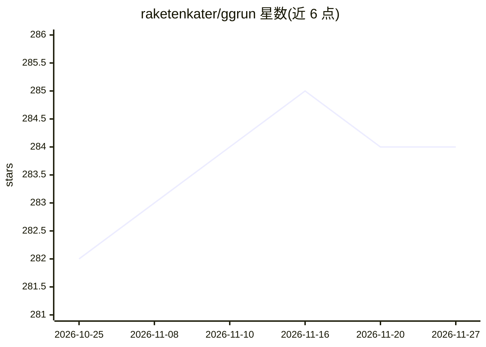

# raketenkater/ggrun

⭐ 284 · Go · MIT · 推送 2026-11-26 · [GitHub](https://github.com/raketenkater/ggrun) · 个人维护

**为多 GPU 主机精确分配显存运行 llama.cpp 大模型的启动器**

ggrun 是 llama.cpp 与 ik_llama.cpp 的启动器：读取 GGUF 与本机 CPU/RAM/GPU/PCIe 拓扑，为异构多卡环境生成并校验 llama-server 启动命令，启动前用后端自身的内存测量确认可装入。提供模型推荐与下载、按带宽加权的专家层放置、Linux 上的 cgroup v2 内存遏制、按架构选择后端，并通过 OpenAI 兼容 /v1 与 /v1/messages 端点对接 Claude Code 等客户端。Linux+NVIDIA 是已测试路径。

## 筛选速览

| 维度 | 判定 | 备注 |
|---|---|---|
| AI 角色 | `ai-ecosystem` | LLM/agent 周边工具 |
| 许可风险 | `permissive` | MIT |
| 部署形态 | `self-host` | docker 或自建部署 |
| 模型依赖 | local-ok | 支持本地模型 |
| 硬件要求 | — | 无带数字的原话,不猜 |
| 安装摩擦 | `low` | 无编译、无系统依赖或容器化 |
| 成熟度 | — | 结构信号不足 |

## 能力要点

- 跨不匹配 GPU 的带宽加权层放置与启动前准入检查
- Linux 上每个后端独立 cgroup v2 内存遏制
- 按模型架构在主线/ik_llama.cpp/fork 间选择后端
- 在检测到的显存/内存范围内给出可启动的模型推荐

## 适用场景

- 把大 MoE 模型拆到 PCIe 链路不均的多卡主机上运行
- 为 Claude Code 长会话在本地启动稳定的大上下文后端
- 安装前先知道哪些模型与量化能装进这台机器

## 场景标签

`推理引擎` · 领域:训练与推理

## 证据(README 行号)

> L3: A launcher for llama.cpp and ik_llama.cpp. It recommends a model for your machine, places it across mismatched GPUs 
> L5: ggrun is not an inference engine. It reads the GGUF and the hardware: CPU, RAM, GPUs and PCIe links. From those it b
> L64: ## What it adds on top of llama-server

## 星数曲线

2026-10-25 282 → 2026-11-27 284（+2）

---
*卡片 v1 · prompt 1.4 · 生成 2026-11-25 · 置信度 mid · 依据 README sha `4ef646adfd7d` · [字段定义](../../DATASET.md)*
