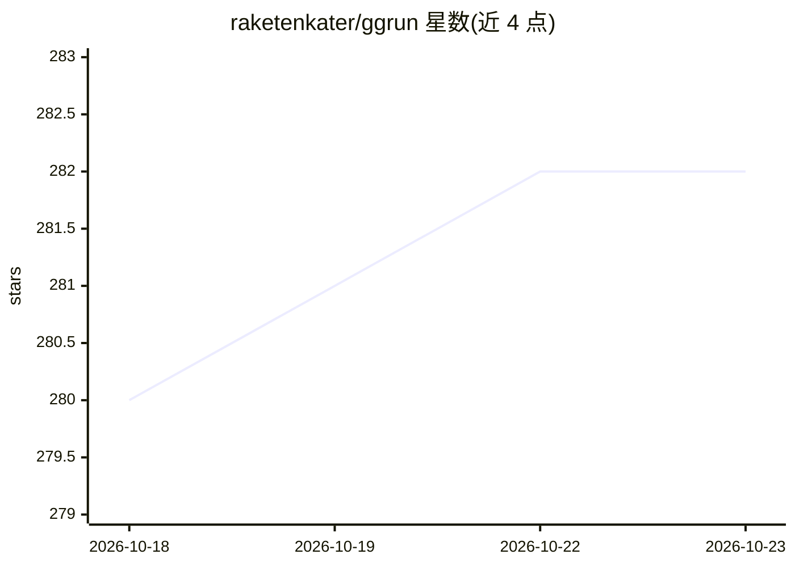

# raketenkater/ggrun

⭐ 282 · Go · MIT · 推送 2026-10-21 · [GitHub](https://github.com/raketenkater/ggrun) · 个人维护

**本地 GGUF 模型启动器：按显存/内存精确规划并启动 llama.cpp 后端**

基于 Go 的终端工具，读取 GGUF 文件与本机硬件信息（VRAM、RAM、GPU 带宽），为 llama.cpp / ik_llama.cpp 等后端生成并校验启动计划，随后启动 llama-server；本身不是推理引擎，未知旗标透传给 llama-server。支持大型 MoE 模型跨多 GPU 与系统 RAM 分布、模型推荐、从 Hugging Face 下载、--ai-tune 有界性能调优，并可将 OpenAI /v1 与 Anthropic 兼容端点接入 Claude Code 本地工作流。macOS 后端为弃用且尽力维护状态。

## 筛选速览

| 维度 | 判定 | 备注 |
|---|---|---|
| AI 角色 | `ai-ecosystem` | LLM/agent 周边工具 |
| 许可风险 | `permissive` | MIT |
| 部署形态 | `None` |  |
| 模型依赖 | local-ok | 支持本地模型 |
| 硬件要求 | — | 无带数字的原话,不猜 |
| 安装摩擦 | `medium` | 含编译或系统依赖之一 |
| 成熟度 | `idea` | |

## 能力要点

- 读取 GGUF 与机器信息生成后端启动计划，启动前校验模型/KV-cache/安全余量内存
- 支持大型 MoE 跨多 GPU 与 RAM 分布，含 NVIDIA 主机-设备带宽实测
- --ai-tune 测量有界安全旗标组合并保留最优配置
- 暴露 OpenAI 兼容 /v1 API 与 Anthropic 端点，--claude-code 接入本地 Claude Code

## 适用场景

- 在显存不匹配的多 GPU 机器上跑大 MoE 模型
- 不知道选什么模型时按硬件获得推荐并一键下载启动
- 把本地模型接给 Claude Code 做编码与 agent 任务
- 自动调优后端旗标并固化最优启动配置

## 场景标签

 · 领域:LLM 基础设施/本地推理

## 证据(README 行号)

> L15: Underneath, ggrun uses llama.cpp,
> L20: ggrun is not an inference engine. It reads the GGUF and the machine, builds a
> L123: - Exposes llama.cpp's OpenAI-compatible `/v1` API (chat completions and

## 星数曲线

2026-10-18 280 → 2026-10-23 282（+2）

---
*卡片 v1 · prompt 1.4 · 生成 2026-10-22 · 置信度 high · 依据 README sha `53912482ca94` · [字段定义](../../DATASET.md)*
