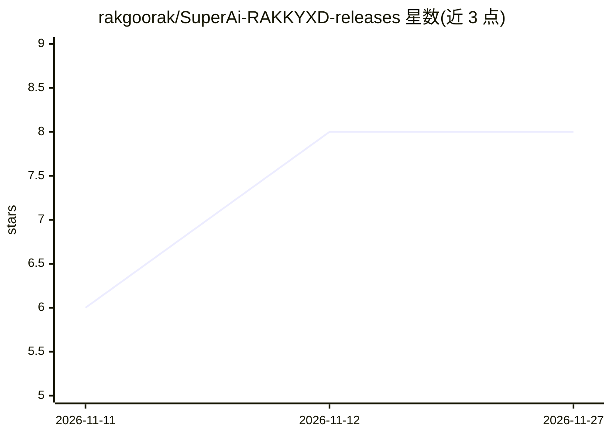

# rakgoorak/SuperAi-RAKKYXD-releases

⭐ 8 · HTML · 推送 2026-11-26 · [GitHub](https://github.com/rakgoorak/SuperAi-RAKKYXD-releases) · [官网](https://rakgoorak.github.io/SuperAi-RAKKYXD/) · 个人维护 · 中文 README

**SuperAi & RAKKYXD 桌面应用的安装包分发仓库**

该仓库本身不承载代码，仅托管 SuperAi 与 RAKKYXD 两个桌面应用的 Windows 安装器（Setup.exe）、macOS dmg（Apple Silicon/Intel）以及便携版 ZIP 和 SHA-256 校验文件；应用通过此仓库检查并获取更新。源码、问题反馈与讨论移至 rakgoorak/SuperAi-RAKKYXD 主仓库，网站提供泰语页面。仓库主题标签显示其与 claude、codex、ollama、llm、electron、local-first 相关，属于面向开发者的桌面 AI 工具的分发端。

## 筛选速览

| 维度 | 判定 | 备注 |
|---|---|---|
| AI 角色 | `ai-enhanced` | 去掉 AI 部分产品仍成立 |
| 许可风险 | `none` | — |
| 部署形态 | `desktop` | 安装包/桌面程序 |
| 模型依赖 | — | README 未给出锁定关系 |
| 硬件要求 | — | 无带数字的原话,不猜 |
| 安装摩擦 | `low` | 无编译、无系统依赖或容器化 |
| 成熟度 | — | 结构信号不足 |

## 能力要点

- 托管 Windows 10/11 64-bit 安装器与 macOS arm64/x64 dmg
- 提供便携版 ZIP 与每文件的 .sha256 校验和
- 应用通过该仓库自动检查更新
- 源码与讨论位于独立主仓库，本仓库仅做分发

## 适用场景

- 下载 SuperAi / RAKKYXD 桌面应用的最新安装包
- 通过 SHA-256 校验和核对下载文件完整性
- 为已有安装的客户端获取版本更新

## 场景标签

 · 领域:开发者工具/桌面应用分发

## 证据(README 行号)

> L8: This repository only hosts the installers. The app checks it for updates, so it stays here.
> L10: - **Source code, issues and discussions:** rakgoorak/SuperAi-RAKKYXD

## 星数曲线

2026-11-11 6 → 2026-11-27 8（+2）

---
*卡片 v1 · prompt 1.4 · 生成 2026-11-20 · 置信度 low · 依据 README sha `faffc824367d` · [字段定义](../../DATASET.md)*
