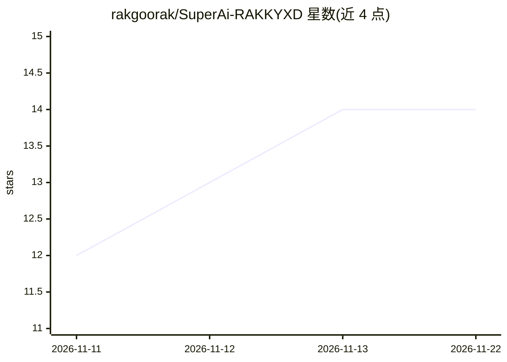

# rakgoorak/SuperAi-RAKKYXD

⭐ 14 · TypeScript · MIT · 推送 2026-11-19 · [GitHub](https://github.com/rakgoorak/SuperAi-RAKKYXD) · [官网](https://rakgoorak.github.io/SuperAi-RAKKYXD/) · 个人维护 · 中文 README

**统一多家 AI 编程助手的本地优先桌面工作区**

基于 Electron 的开源桌面应用，面向同时使用多个 AI 编程助手的开发者：将 Claude Code、Codex、Antigravity、OpenCode、Freebuff 及本地 Ollama 的会话、项目文件夹、终端与预览集成到一个工作区。提供 Agent（主代理加 1–6 个子代理）、Code（多 CLI/终端会话）与 Chat（1–5 个模型对比回答）三种模式，附带 Git worktree、本地 Whisper 泰/英听写、用量配额查看等工具。提供 Windows 与 macOS 安装包，也可从源码构建；不运营 AI 中继服务器，提示词由所选 provider/CLI 处理。

## 筛选速览

| 维度 | 判定 | 备注 |
|---|---|---|
| AI 角色 | `ai-ecosystem` | LLM/agent 周边工具 |
| 许可风险 | `permissive` | MIT |
| 部署形态 | `desktop` | 安装包/桌面程序 |
| 模型依赖 | local-ok | 支持本地模型 |
| 硬件要求 | — | 无带数字的原话,不猜 |
| 安装摩擦 | `low` | 无编译、无系统依赖或容器化 |
| 成熟度 | — | 结构信号不足 |

## 能力要点

- 集成 Claude Code、Codex、Antigravity、OpenCode、Freebuff 与本地 Ollama 六类 provider
- Agent/Code/Chat 三模式：子代理协作、多终端会话、多模型回答对比
- Git worktree、本地 Whisper 泰/英听写、provider 用量配额查看
- 本地优先：设置与对话历史存储在本机，不运营 AI 中继服务器

## 适用场景

- 在单一窗口中并行使用多个 AI 编程助手
- 让主代理拆解并分派任务给子代理完成项目工作
- 同一提示词发给多个模型对比回答后合成结论

## 场景标签

`编码 Agent` · 领域:编码与开发

## 证据(README 行号)

> L24: SuperAi &amp; RAKKYXD is an open-source desktop workspace for people who work across several AI coding assistants. 
> L26: It supports Claude Code, Codex, Antigravity (<code>agy</code>), OpenCode, Freebuff and local Ollama. Provider avail

## 星数曲线

2026-11-11 12 → 2026-11-22 14（+2）

---
*卡片 v1 · prompt 1.4 · 生成 2026-11-18 · 置信度 mid · 依据 README sha `e05a95744bc4` · [字段定义](../../DATASET.md)*
