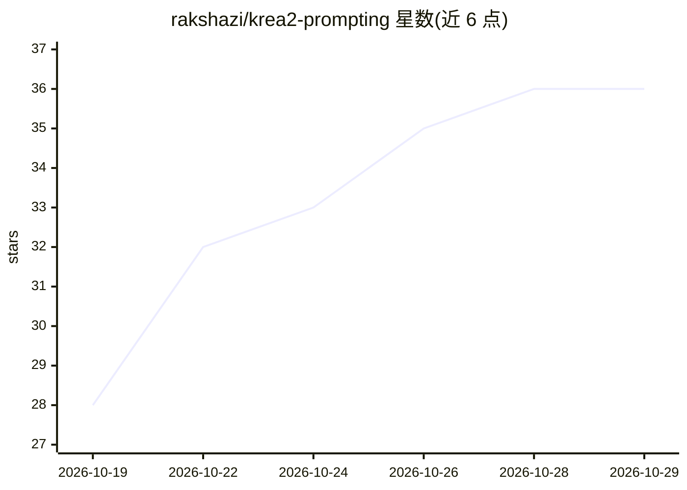

# rakshazi/krea2-prompting

⭐ 36 · CC-BY-SA-4.0 · 推送 2026-10-24 · [GitHub](https://github.com/rakshazi/krea2-prompting) · [官网](https://rakshazi.me/blog/krea2-prompting-skill/) · 个人维护

**Krea 2 (Turbo) 文生图提示词 agent 技能库**

面向 ComfyUI 上 Krea 2 Turbo 模型的 agent skill（SKILL.md 格式参考库）：不含模型与权重，只提供提示词写法、设置、姿势块、289 个风格名与逐条实测记录（同 checkpoint 同种子、单变量对照）。文本编码器为 Qwen3-VL，方法论为写句子而非标签堆叠。含 18+ 成人内容文件与评测触发器 JSON。通过 git clone 到 Claude Code / omp 等 agent 技能目录安装，任何加载 SKILL.md 的运行时均可用。

## 筛选速览

| 维度 | 判定 | 备注 |
|---|---|---|
| AI 角色 | `ai-knowledge` | 知识聚合/清单类 |
| 许可风险 | `viral` | CC-BY-SA-4.0 |
| 部署形态 | `library` | 以包/库形式分发 |
| 模型依赖 | locked-api |  |
| 硬件要求 | — | 无带数字的原话,不猜 |
| 安装摩擦 | `low` | 无编译、无系统依赖或容器化 |
| 成熟度 | — | 结构信号不足 |

## 能力要点

- SKILL.md 入口 + 10 余个参考文件（摄影写实、核心架构、ComfyUI 设置、姿势库、风格索引等）
- 30 个即贴姿势块与 11 字段姿势 schema
- 289 个风格名、两个风格撰写公式
- 每条 tested 声明来自本地同种子单变量实测

## 适用场景

- 让 Claude Code 等 agent 按实测规则为 Krea 2 生成提示词与设置
- 查询特定题材（巨构建筑、巨兽、宇宙恐怖等）的提示词写法
- 对照失败词表避免无效措辞

## 场景标签

`提示工程` `图像生成` · 领域:Agent 开发

## 证据(README 行号)

> L9: This repo is the result. It is an agent skill for Krea 2 Turbo in ComfyUI: prompts, settings, pose blocks, style nam
> L41: |`SKILL.md`|The entrypoint. Mental model, ComfyUI defaults, prompt order, workflow, pre-flight rules. Start here.|
> L86: The frontmatter follows the Agent Skills spec: `name`, `description`, `license`, `compatibility`, and a `metadata` 

## 星数曲线

2026-10-19 28 → 2026-10-29 36（+8）

---
*卡片 v1 · prompt 1.4 · 生成 2026-10-25 · 置信度 mid · 依据 README sha `09929a85f92a` · [字段定义](../../DATASET.md)*
