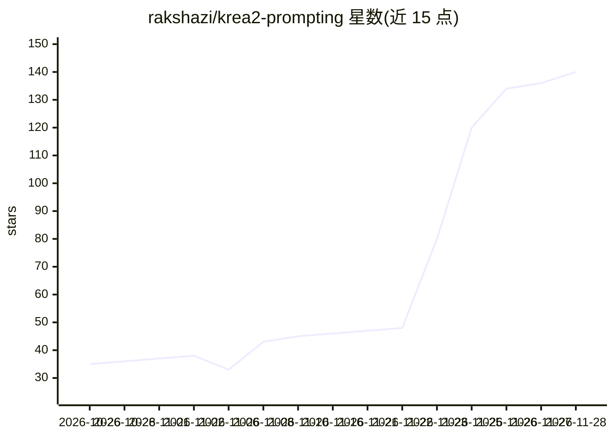

# rakshazi/krea2-prompting

⭐ 140 · Python · CC-BY-SA-4.0 · 推送 2026-11-27 · [GitHub](https://github.com/rakshazi/krea2-prompting) · [官网](https://rakshazi.me/blog/krea2-prompting-skill/) · 个人维护

**Krea 2 Turbo 提示词 agent 技能，附大量参考库**

一个面向 ComfyUI 中 Krea 2 Turbo 图像生成的 Agent Skill（SKILL.md 规范）：包含提示词写法、ComfyUI 默认参数、姿势块、风格名索引及经本地测试的措辞效果记录，分 12 个按需加载的参考文件，含成人（18+）章节。所有结论来自作者本地同种子对照测试，仓库不含模型权重。安装方式是 git clone 到 agent 技能目录（Claude Code 等运行时），基于 buxinzi2233/krea2-prompting（MIT）并改为 CC BY-SA 4.0。

## 筛选速览

| 维度 | 判定 | 备注 |
|---|---|---|
| AI 角色 | `ai-knowledge` | 知识聚合/清单类 |
| 许可风险 | `viral` | CC-BY-SA-4.0 |
| 部署形态 | `library` | 以包/库形式分发 |
| 模型依赖 | — | README 未给出锁定关系 |
| 硬件要求 | — | 无带数字的原话,不猜 |
| 安装摩擦 | `low` | 无编译、无系统依赖或容器化 |
| 成熟度 | — | 结构信号不足 |

## 能力要点

- SKILL.md 入口加 12 个按需加载的参考文件（姿势/风格/写实/局部重绘等）
- 289 个风格名索引与 30 个可粘贴姿势块
- 成人章节为最大且测试最多部分（18+）
- 附 evals 维护工具（lint.py/触发查询/评测集）

## 适用场景

- 让 Claude Code 等技能运行时代为撰写 Krea 2 的 ComfyUI 提示词与参数
- 按参考图反推提示词并保持角色/构图一致
- 查询经测试验证的风格名、姿势块与失败措辞表

## 场景标签

`提示工程` `图像生成` · 领域:Agent 开发

## 证据(README 行号)

> L9: This repo is the result. It is an agent skill for Krea 2 Turbo in ComfyUI: prompts, settings, pose blocks, style nam
> L45: |`SKILL.md`|The entrypoint. Mental model, ComfyUI defaults, prompt order, workflow, the six checks every prompt get

## 星数曲线

2026-10-26 35 → 2026-11-28 140（+105）

---
*卡片 v1 · prompt 1.4 · 生成 2026-11-28 · 置信度 high · 依据 README sha `184fc646ae89` · [字段定义](../../DATASET.md)*
