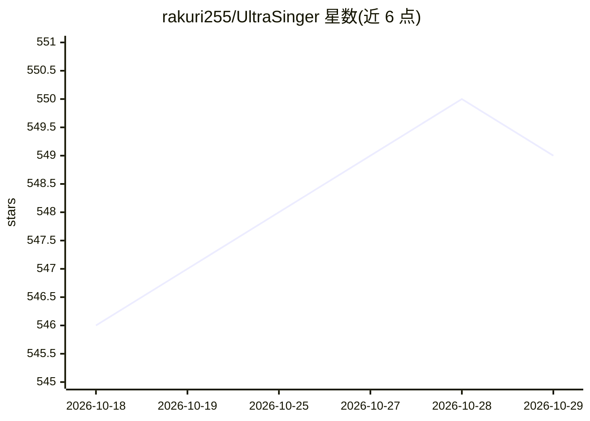

# rakuri255/UltraSinger

⭐ 549 · Python · MIT · 推送 2026-06-30 · [GitHub](https://github.com/rakuri255/UltraSinger) · 个人维护

**从歌曲自动生成 UltraStar 卡拉OK、MIDI 与乐谱的 AI 工具**

面向卡拉OK/音乐爱好者的命令行工具：输入本地音频、YouTube 链接或已有 UltraStar 文件，使用多个 AI 模型完成人声分离、Whisper 歌词转录、SwiftF0 音高检测，自动生成 UltraStar.txt、MIDI 与音符文件，并可重新校准已有文件的音高、计算游戏内得分。可选 MuseScore 生成乐谱，支持 NVIDIA CUDA GPU 加速（可选）或纯 CPU 运行，提供 Docker/Podman 容器方案与 Colab 入口。项目自述仍在开发中，部分选项未完成，仅建议用于知识共享许可的歌曲。

## 筛选速览

| 维度 | 判定 | 备注 |
|---|---|---|
| AI 角色 | `ai-native` | 本体是模型或模型工具 |
| 许可风险 | `permissive` | MIT |
| 部署形态 | `desktop` | 安装包/桌面程序 |
| 模型依赖 | — | README 未给出锁定关系 |
| 硬件要求 | `cpu-ok` | |
| 安装摩擦 | `medium` | 含编译或系统依赖之一 |
| 成熟度 | `idea` | |

## 能力要点

- Whisper 转录 + SwiftF0 音高检测自动生成 UltraStar/MIDI 文件
- 支持本地音频、YouTube 链接与已有 UltraStar 文件重校音高
- GPU（CUDA）/CPU 双路径，安装脚本按系统自动配置
- 可重新校准已有文件并计算游戏内简单/精确两种得分

## 适用场景

- 把自己喜欢的歌转成 UltraStar 卡拉OK文件
- 重新校准音高不准的旧 UltraStar 文件
- 从人声生成 MIDI 与乐谱（需 MuseScore）

## 场景标签

`语音识别` · 领域:感知与多模态

## 证据(README 行号)

> L18: UltraSinger is a tool to automatically create UltraStar.txt, midi and notes from music.
> L22: Multiple AI models are used to extract text from the voice and to determine the pitch.

## 星数曲线

2026-10-18 546 → 2026-10-29 549（+3）

---
*卡片 v1 · prompt 1.4 · 生成 2026-10-21 · 置信度 mid · 依据 README sha `9e5c20d85c63` · [字段定义](../../DATASET.md)*
