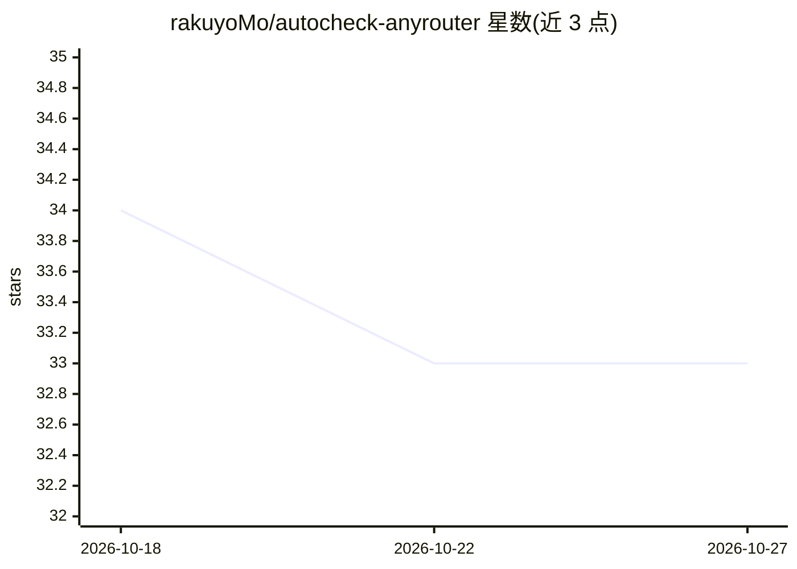

# rakuyoMo/autocheck-anyrouter

⭐ 33 · Python · NOASSERTION · 推送 2026-05-14 · [GitHub](https://github.com/rakuyoMo/autocheck-anyrouter) · [官网](https://anyrouter.top/register?aff=sL91) · 个人维护 · 中文 README

**GitHub Actions 定时自动签到工具：面向 Claude Code API 中转站（多账号）**

基于 Python 与 GitHub Actions 的多账号自动签到工具，签到目标为 Claude Code API 中转站（主题标签含 claude-code/codex/ai），基于上游项目 millylee/any-router-check-in 实现核心签到功能。支持两种运行方式：Fork 仓库定时运行（每 6 小时）与 Composite Action 集成到自有仓库。账号经环境变量配置（数组格式或前缀格式，可字段覆盖），支持 8 种通知平台（邮箱/钉钉/飞书/企业微信/PushPlus/Server酱/Bark/Telegram），通知内容可用 Stencil 模板自定义，并可设置触发时机（余额变化/失败等）。带智能隐私保护：公开仓库自动脱敏账号名与余额。限制：GitHub 定时存在延迟；session cookie 约一个月失效需重新获取。

## 筛选速览

| 维度 | 判定 | 备注 |
|---|---|---|
| AI 角色 | `ai-ecosystem` | LLM/agent 周边工具 |
| 许可风险 | `none` | NOASSERTION |
| 部署形态 | `desktop` | 安装包/桌面程序 |
| 模型依赖 | — | README 未给出锁定关系 |
| 硬件要求 | — | 无带数字的原话,不猜 |
| 安装摩擦 | `low` | 无编译、无系统依赖或容器化 |
| 成熟度 | — | 结构信号不足 |

## 能力要点

- 单/多账号自动签到，Fork 定时与 Composite Action 两种接入方式
- 8 种通知平台 + Stencil 模板自定义标题与内容
- 公开仓库自动脱敏账号名称与余额信息
- 通知触发时机可配置（余额变化/签到失败/总是等）

## 适用场景

- 我在 Claude Code API 中转站有账号，想用 GitHub Actions 自动维持每日签到
- 我有多个中转站账号，需要合并管理并统一接收签到结果通知
- 我在自有仓库工作流中以 Composite Action 方式调用签到步骤

## 场景标签

 · 领域:开发工具/自动化

## 证据(README 行号)

> L3: > 基于 Python 的 AnyRouter 多账号自动签到工具，支持多种通知方式和智能隐私保护
> L17: - [x] 单个/多账号自动签到

## 星数曲线

2026-10-18 34 → 2026-10-27 33（-1）

---
*卡片 v1 · prompt 1.4 · 生成 2026-10-25 · 置信度 mid · 依据 README sha `0c8c1e70e6bb` · [字段定义](../../DATASET.md)*
