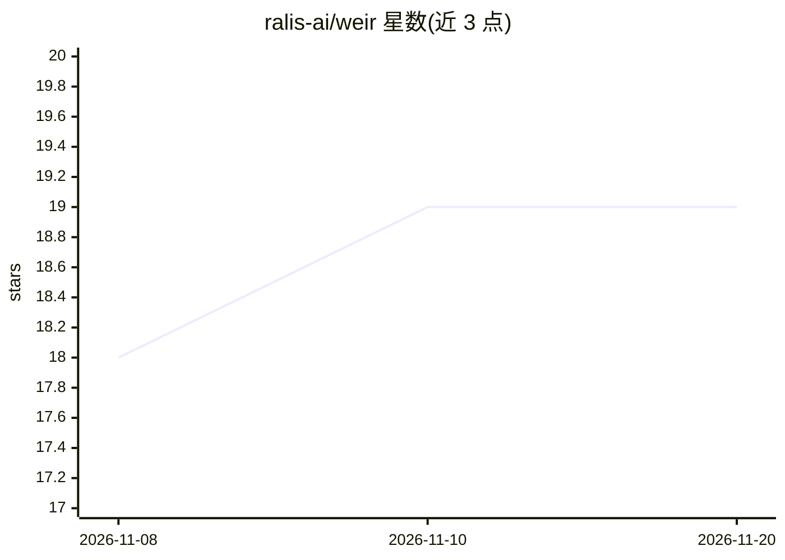

# ralis-ai/weir

⭐ 19 · Python · Apache-2.0 · 推送 2026-11-18 · [GitHub](https://github.com/ralis-ai/weir) · 组织维护

**检测 AI agent 泄露 API key 的安全测试与审计工具**

面向构建和使用 agent 的开发者与安全工程师：在 agent 环境中植入伪造 key，运行 agent 自身流程并对所有 spans、日志、metrics、控制台输出、模型提示词与外部请求做精确值匹配，给出 leak/clean/incomplete 判定与退出码。针对 Claude Code 会话提供状态栏统计（多少真实 key 进入上下文或经工具调用外发）与可选脱敏 hook，在模型读取前替换已知 key。全流程离线确定性，不依赖 AI 模型判定。曾发现 MLflow 的 CVE-2026-116691。限制：仅匹配完整值，网络隔离仅限 Linux 且需非特权 user namespaces。

## 筛选速览

| 维度 | 判定 | 备注 |
|---|---|---|
| AI 角色 | `ai-ecosystem` | LLM/agent 周边工具 |
| 许可风险 | `permissive` | Apache-2.0 |
| 部署形态 | `library` | 以包/库形式分发 |
| 模型依赖 | — | README 未给出锁定关系 |
| 硬件要求 | — | 无带数字的原话,不猜 |
| 安装摩擦 | `low` | 无编译、无系统依赖或容器化 |
| 成熟度 | — | 结构信号不足 |

## 能力要点

- 植入伪 key 后对 spans/日志/metrics/提示词/外部请求做精确值匹配判定
- Claude Code 状态栏统计 key 进入/外发，可选 hook 在模型读取前脱敏
- 离线确定性：无 AI 模型参与判定，测试环境不外发数据
- CI 集成：GitHub Action 一步运行并将判定结果评论到 PR

## 适用场景

- 在 CI 中检测自研 agent 是否把凭据泄露到日志、trace 或模型上下文
- 监控自己的 Claude Code 会话中有哪些真实 key 被读取或外发
- 对已有 trace 做敏感数据流向追踪与凭据盘点

## 场景标签

`网络安全` · 领域:学习与行业

## 证据(README 行号)

> L5: - **The agents you build:** plant fake keys where your real ones live, run the agent's own flows, and get a verdict 
> L25: `weir-run` plants a unique fake key wherever a real one would live, runs your agent's own flows against a local fak
> L67: - **It checks every way out:** spans, logs, metrics, console output, prompts sent to the model, and requests to any

## 星数曲线

2026-11-08 18 → 2026-11-20 19（+1）

---
*卡片 v1 · prompt 1.4 · 生成 2026-11-18 · 置信度 high · 依据 README sha `caa9988f19da` · [字段定义](../../DATASET.md)*
