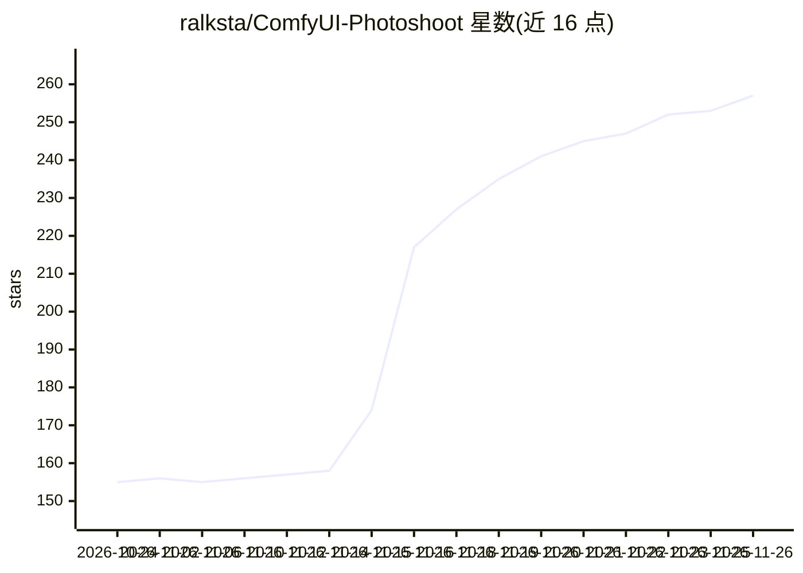

# ralksta/ComfyUI-Photoshoot

⭐ 257 · Python · MIT · 推送 2026-11-24 · [GitHub](https://github.com/ralksta/ComfyUI-Photoshoot) · 个人维护

**为 ComfyUI 生成同一人物系列提示词的自定义节点集**

一组 ComfyUI 自定义节点（22 个），将人物定义（38 字段 Person、衣橱、双人）与拍摄调度（10 轴 Series：机位/姿势/表情/景别/光线/场景等）分离，输出英文提示词字符串、像素尺寸与确定性种子；人物在系列中保持一致，最终图像由用户所用 checkpoint/LoRA 决定。核心机制包括 Kronecker 确定性种子序列与景别耦合的字段缩短规则；内置 Studio 侧栏、Lightbox 选片面板与 LoRA 训练数据导出节点。仅通过 ComfyUI Manager 或 git clone 安装，无额外运行时依赖。

## 筛选速览

| 维度 | 判定 | 备注 |
|---|---|---|
| AI 角色 | `ai-ecosystem` | LLM/agent 周边工具 |
| 许可风险 | `permissive` | MIT |
| 部署形态 | `None` |  |
| 模型依赖 | — | README 未给出锁定关系 |
| 硬件要求 | — | 无带数字的原话,不猜 |
| 安装摩擦 | `low` | 无编译、无系统依赖或容器化 |
| 成熟度 | — | 结构信号不足 |

## 能力要点

- 10 轴系列规划：24 姿势、94 表情、17 场景、30 光线等词库池
- 确定性 Kronecker 种子序列，可从任意照片号续拍或重拍
- Studio 侧栏 + 4 套预置工作流，支持双人（Couples）输入
- Save Dataset 节点导出 NNNN.png+txt 的 LoRA 训练数据

## 适用场景

- 为同一人物角色批量生成多景别、多姿势的图像系列
- 从锚点图生成 LoRA 训练用的图文数据集
- 在 ComfyUI 里用侧栏交互式地配置人物与拍摄方案

## 场景标签

`提示工程` `图像生成` `微调` · 领域:Agent 开发

## 证据(README 行号)

> L25: **Build a person once. Now shoot 40 photos of her.** Photoshoot generates structured natural-language prompt series
> L30: > **Text nodes by design:** Every builder and Series node emits English prompt strings, pixel dimensions, and deter
> L34: No runtime dependencies beyond ComfyUI itself. Install via **ComfyUI Manager** (*Photoshoot*) or clone directly:

## 星数曲线

2026-10-24 155 → 2026-11-26 257（+102）

---
*卡片 v1 · prompt 1.4 · 生成 2026-11-25 · 置信度 mid · 依据 README sha `4a267ba4bb8a` · [字段定义](../../DATASET.md)*
