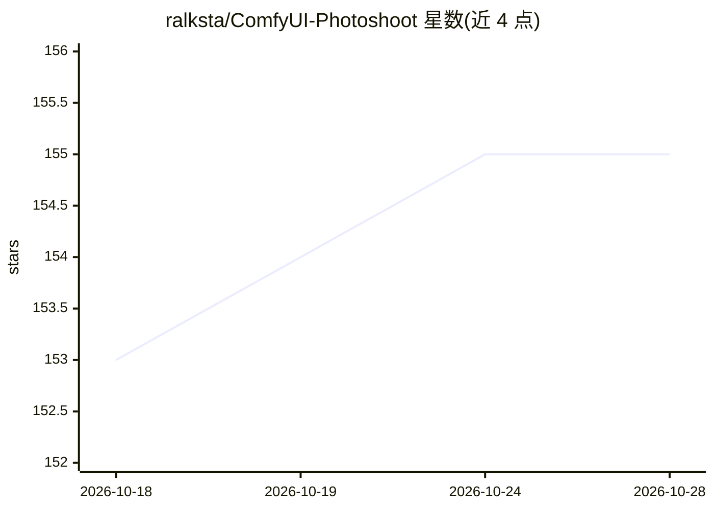

# ralksta/ComfyUI-Photoshoot

⭐ 155 · Python · MIT · 推送 2026-09-21 · [GitHub](https://github.com/ralksta/ComfyUI-Photoshoot) · 个人维护

**ComfyUI 节点集：一次构建人物，批量生成同人多角度写真系列**

ComfyUI 自定义节点集，分两部分：Person Builder 以 37 个字段描述人物（体型、面部、发型、妆容）并保存；Wardrobe 以标签页管理服装。Photoshoot 节点将人物转为整组系列：每张照片变化构图、姿势、表情与宽高比，人物保持一致，可自动排队 40 次运行。节点产出英文提示词字符串交给用户的采样器，图片效果取决于用户自己的扩散模型；仓库示例使用 Krea 2 Turbo 与 Qwen-VL 渲染。七条变化轴均可关闭或限定范围，序列使用 Kronecker 序列保证可复现。

## 筛选速览

| 维度 | 判定 | 备注 |
|---|---|---|
| AI 角色 | `ai-ecosystem` | LLM/agent 周边工具 |
| 许可风险 | `permissive` | MIT |
| 部署形态 | `None` |  |
| 模型依赖 | — | README 未给出锁定关系 |
| 硬件要求 | — | 无带数字的原话,不猜 |
| 安装摩擦 | `low` | 无编译、无系统依赖或容器化 |
| 成熟度 | — | 结构信号不足 |

## 能力要点

- 37 字段人物构建器与多套服装 Wardrobe 标签页
- 七条变化轴（构图/姿势/表情/焦点/画幅/服装/噪声）生成可复现系列
- 远摄时自动精简人物提示词 token，避免构图被拉回头部
- 内置 Editorial/Lookbook/Headshots 等一键配方与联络图（contact sheet）预览

## 适用场景

- 为已构建的人物批量生成构图、姿势、表情各异的一致性照片系列
- 服装目录式的换装系列拍摄（每套服装从全景到特写）
- 用不同扩散模型复现同一组人物照片计划

## 场景标签

`图像生成` · 领域:内容生成

## 证据(README 行号)

> L26: > **These nodes write text.** Every node here produces an English prompt string —
> L35: Photoshoot is a set of ComfyUI nodes in two halves. The **Person Builder** describes

## 星数曲线

2026-10-18 153 → 2026-10-28 155（+2）

---
*卡片 v1 · prompt 1.4 · 生成 2026-10-22 · 置信度 high · 依据 README sha `9ef19a7e32f3` · [字段定义](../../DATASET.md)*
