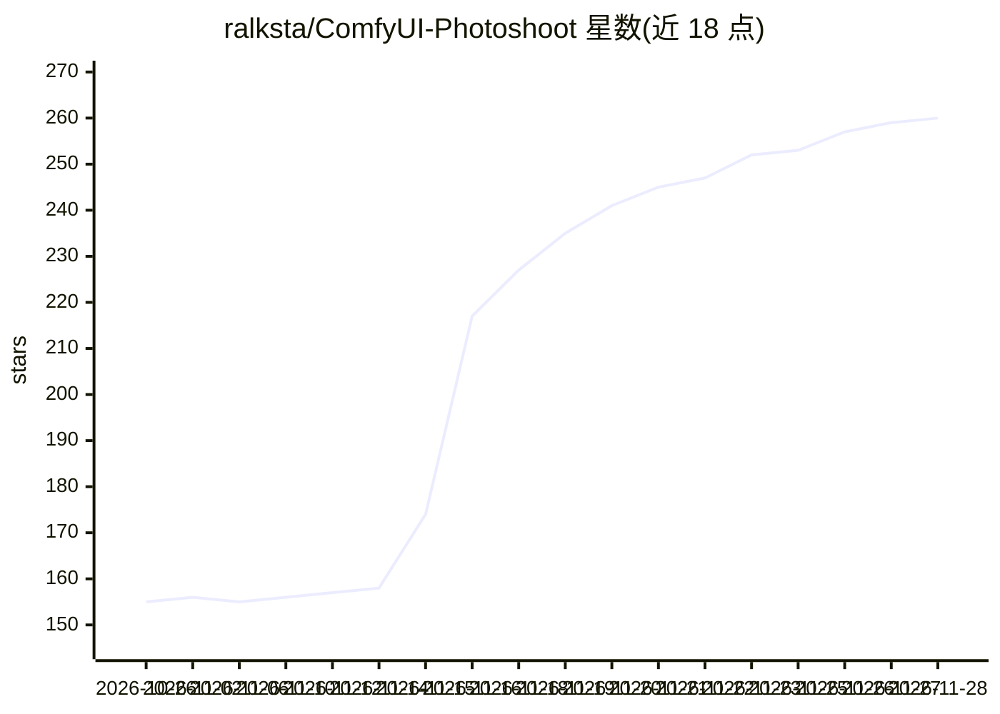

# ralksta/ComfyUI-Photoshoot

⭐ 260 · Python · MIT · 推送 2026-11-24 · [GitHub](https://github.com/ralksta/ComfyUI-Photoshoot) · 个人维护

**ComfyUI 节点集：构建一次人物，生成保持一致的多图拍摄提示词系列**

为 ComfyUI 提供的提示词编排节点集：Person Builder 用 38 个字段描述人物，Series 节点沿相机、视角、姿势、表情、构图、光照等 10 个轴生成结构化英文提示词、像素尺寸与确定性种子，仅 Monochrome 节点触及像素，最终画面取决于用户的 checkpoint、LoRA 与采样器。含 Studio 侧栏、Lightbox 选片、Director 一句话生成拍摄 JSON、可渲染验证的参考海报矩阵与 LoRA 训练数据导出。描述对象限定成年人。

## 筛选速览

| 维度 | 判定 | 备注 |
|---|---|---|
| AI 角色 | `ai-ecosystem` | LLM/agent 周边工具 |
| 许可风险 | `permissive` | MIT |
| 部署形态 | `None` |  |
| 模型依赖 | — | README 未给出锁定关系 |
| 硬件要求 | — | 无带数字的原话,不猜 |
| 安装摩擦 | `low` | 无编译、无系统依赖或容器化 |
| 成熟度 | — | 结构信号不足 |

## 能力要点

- 10 轴系列规划：构图/视角/姿势/表情/格式/服装/场景/光照/种子等可变或锁定
- 确定性 Kronecker 种子序列与构图耦合的提示词缩短机制
- 22 个节点、5 个预置工作流（含 Z-Image Turbo 与 MiniMax 2K）
- Lightbox 选片、导演一句话生成 shoot JSON、LoRA 训练数据集导出

## 适用场景

- 在 ComfyUI 中为同一人物批量生成系列图像提示词
- 导出 png+txt 数据集用于人物 LoRA 训练
- 按 10 个轴自由组合姿势、光照与场景做风格化拍摄

## 场景标签

`提示工程` `图像生成` `微调` · 领域:Agent 开发

## 证据(README 行号)

> L23: **Build a person once. Now shoot 40 photos of her.** Photoshoot generates structured natural-language prompt series
> L32: No runtime dependencies beyond ComfyUI itself. Install via **ComfyUI Manager** (*Photoshoot*) or clone directly:

## 星数曲线

2026-10-26 155 → 2026-11-28 260（+105）

---
*卡片 v1 · prompt 1.4 · 生成 2026-11-26 · 置信度 high · 依据 README sha `2ac24bbd20f0` · [字段定义](../../DATASET.md)*
