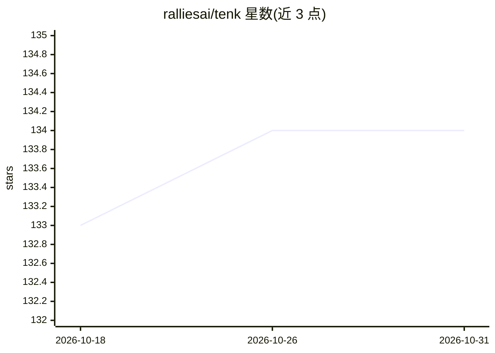

# ralliesai/tenk

⭐ 134 · Python · NOASSERTION · 推送 2025-12-13 · [GitHub](https://github.com/ralliesai/tenk) · [官网](https://rallies.ai) · 组织维护

**用自然语言对话查询 SEC 10-K/10-Q 财报并给出引文回答**

面向投资者的财报问答 CLI 工具：自动从 SEC EDGAR 下载 10-K/10-Q 文件，切块后存入本地向量数据库，用 sentence-transformers 做语义检索，调用 OpenAI 模型生成带来源引用的回答；支持多份财报跨文件对比查询，附 Yahoo Finance 股票数据与网络搜索补充，可导出 PDF/DOCX/Excel。需 Python 3.10+ 与 OPENAI_API_KEY，以 pip 包或源码安装，通过 tenk 命令交互或一次性提问使用。限制：许可证为个人/非商业用途，禁止商用。

## 筛选速览

| 维度 | 判定 | 备注 |
|---|---|---|
| AI 角色 | `ai-native` | 本体是模型或模型工具 |
| 许可风险 | `none` | NOASSERTION |
| 部署形态 | `library` | 以包/库形式分发 |
| 模型依赖 | — | README 未给出锁定关系 |
| 硬件要求 | — | 无带数字的原话,不猜 |
| 安装摩擦 | `low` | 无编译、无系统依赖或容器化 |
| 成熟度 | — | 结构信号不足 |

## 能力要点

- 自动从 SEC EDGAR 下载 10-K/10-Q 并入本地向量库
- RAG 问答，回答带指向原文的引文链接
- 跨多份财报对比查询（如对比两家公司毛利率）
- 回答可导出 PDF/DOCX/Excel，支持表格与财务模型生成

## 适用场景

- 不用读上百页 10-K，直接问某公司的主要风险因素
- 一次性对比多家公司的财务指标
- 把财报分析结果导出成 Excel 财务模型或 PDF 报告

## 场景标签

`文档问答` `金融量化` · 领域:知识与检索

## 证据(README 行号)

> L5: **Talk to SEC filings with AI**
> L31: - ✅ **RAG** over SEC filings with a local vector database (10-K, 10-Q)
> L87: 4. **AI analysis** - Generates answers with citations

## 星数曲线

2026-10-18 133 → 2026-10-31 134（+1）

---
*卡片 v1 · prompt 1.4 · 生成 2026-10-22 · 置信度 high · 依据 README sha `6eb36062fea5` · [字段定义](../../DATASET.md)*
