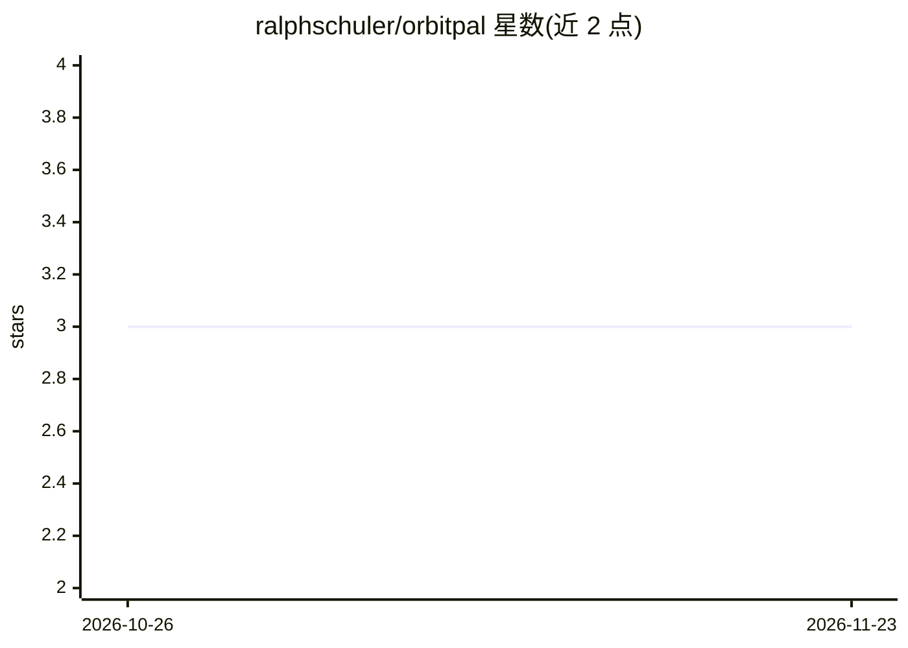

# ralphschuler/orbitpal

⭐ 3 · Rust · NOASSERTION · 推送 2026-11-08 · [GitHub](https://github.com/ralphschuler/orbitpal) · 个人维护

**给主播的桌面 AI 副播：Twitch/YouTube 直播对话与 3D 角色呈现**

基于 Tauri 2 + Rust 与 Svelte 5 + Three.js 的桌面应用，为 Twitch 与 YouTube 直播提供可动画的 AI 副播角色。支持多个独立 bot，各自拥有 persona、语音、模型、技能与权限；支持 VRM/GLB 角色导入、透明角色窗口与 OBS 浏览器源、字幕/手势/语音同步。模型由用户自备：本地走 Ollama/LM Studio，云端走 OpenAI 兼容/Anthropic API，另可接入 Codex 与 Claude Code CLI。含共享 MCP/技能库、可选 Hindsight 长期记忆与本地 PDF 检索。发布 Windows/macOS/Linux 安装包，界面支持四种语言。

## 筛选速览

| 维度 | 判定 | 备注 |
|---|---|---|
| AI 角色 | `ai-native` | 本体是模型或模型工具 |
| 许可风险 | `permissive` | NOASSERTION |
| 部署形态 | `library` | 以包/库形式分发 |
| 模型依赖 | local-ok | 支持本地模型 |
| 硬件要求 | — | 无带数字的原话,不猜 |
| 安装摩擦 | `low` | 无编译、无系统依赖或容器化 |
| 成熟度 | `idea` | |

## 能力要点

- 多 bot 管理：独立 persona/语音/模型/技能/权限，可同台排队发言
- 17 个内置角色，支持 VRM/GLB/glTF 导入与 VRMA 动作
- 共享 MCP/技能库，按 bot 单独授权，操作员/观众工具权限由宿主强制执行
- 可选 Hindsight 长期记忆与带来源引用的本地 PDF/文本检索

## 适用场景

- 直播时让 AI 角色自动或手动回复 Twitch/YouTube 聊天
- 用本地模型驱动的虚拟角色主持直播
- 通过 OBS 浏览器源把 3D 角色叠加到直播画面

## 场景标签

`AI 助手` · 领域:对话与助手

## 证据(README 行号)

> L9: Your own animated AI cohost for Twitch and YouTube. A native **Tauri 2 + Rust** desktop app with a **Svelte 5 + Thre
> L21: - Local models through Ollama, LM Studio or compatible APIs; cloud models through OpenAI-compatible/Anthropic APIs;

## 星数曲线

2026-10-26 3 → 2026-11-23 3（+0）

---
*卡片 v1 · prompt 1.4 · 生成 2026-11-21 · 置信度 mid · 依据 README sha `baec5de0729a` · [字段定义](../../DATASET.md)*
