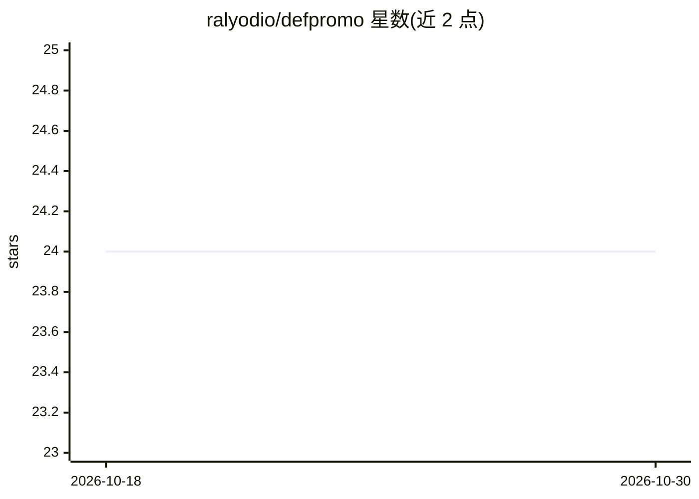

# ralyodio/defpromo

⭐ 24 · JavaScript · 推送 2026-09-14 · [GitHub](https://github.com/ralyodio/defpromo) · [官网](https://defpromo.com) · 个人维护

**浏览器扩展：基于产品简介生成社交媒体帖子与回复草稿**

面向 Chrome/Edge、Firefox 与 Safari 的浏览器扩展，用于社媒自我推广：读取网站的 openprofile.md 与 llms.txt（无则用抓取服务）生成项目简介，再据此产出可编辑的帖子/回复变体，并自动填入 Twitter/X、LinkedIn、Reddit、Facebook 的发布框。AI 接入通过 myna（默认）或用户自有 OpenAI key；仅填表不代发帖。项目、草稿与活动记录存于本地 IndexedDB，支持 JSON 导入导出。Safari 需 Xcode 转换与签名。

## 筛选速览

| 维度 | 判定 | 备注 |
|---|---|---|
| AI 角色 | `ai-native` | 本体是模型或模型工具 |
| 许可风险 | `none` | — |
| 部署形态 | `library` | 以包/库形式分发 |
| 模型依赖 | — | README 未给出锁定关系 |
| 硬件要求 | — | 无带数字的原话,不猜 |
| 安装摩擦 | `low` | 无编译、无系统依赖或容器化 |
| 成熟度 | — | 结构信号不足 |

## 能力要点

- 读取 /.well-known/openprofile.md 与 /llms.txt 构建产品简介，缺失时回退到抓取服务
- 生成帖子/回复变体，人工审阅后自动填入支持平台的发布框
- 支持 myna（一次性 setup token）或自有 OpenAI key 作为生成提供方
- 项目/草稿/记录存本地 IndexedDB，可 JSON 导入导出

## 适用场景

- 为自己的产品在多个社交平台撰写并填写推广帖子和回复
- 管理多个产品的简介、受众与语气并复用草稿
- 本地记录各平台的表单填写次数与手动录入的互动数据

## 场景标签

`AI 写作` `浏览器自动化` · 领域:效率与自动化

## 证据(README 行号)

> L3: Draft, edit and reuse social posts and replies from your product brief. DefPromo keeps projects and writing history 
> L106: In 1.5.0+, the selected provider reads supported site files first, then uses a scraper when needed. AI turns that 
> L113: 4. Click "Generate Variations"

## 星数曲线

2026-10-18 24 → 2026-10-30 24（+0）

---
*卡片 v1 · prompt 1.4 · 生成 2026-10-27 · 置信度 mid · 依据 README sha `960af86411a2` · [字段定义](../../DATASET.md)*
