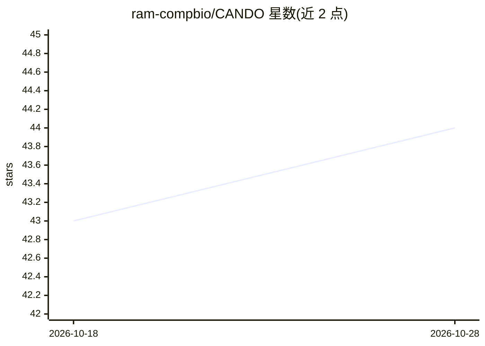

# ram-compbio/CANDO

⭐ 44 · Python · BSD-3-Clause · 推送 2026-07-23 · [GitHub](https://github.com/ram-compbio/CANDO) · [官网](http://compbio.org/protinfo/cando) · 组织维护

**多尺度药物发现、重定位与设计平台，供计算生物医学研究者使用**

CANDO 是一个面向治疗药物发现、重定位与设计的多尺度计算平台，覆盖生物信息学与机器学习方法。面向科研用户，通过 Anaconda/conda-forge 渠道安装（conda install -c ram-compbio cando），也可下载源码或克隆仓库。提供 Jupyter notebook 教程（可从 anaconda 下载）、API 文档与安装测试脚本 run_test.py。README 较简略，具体算法与数据细节指向其网站与 ACKNOWLEDGEMENTS。

## 筛选速览

| 维度 | 判定 | 备注 |
|---|---|---|
| AI 角色 | `ai-native` | 本体是模型或模型工具 |
| 许可风险 | `permissive` | BSD-3-Clause |
| 部署形态 | `None` |  |
| 模型依赖 | — | README 未给出锁定关系 |
| 硬件要求 | — | 无带数字的原话,不猜 |
| 安装摩擦 | `low` | 无编译、无系统依赖或容器化 |
| 成熟度 | — | 结构信号不足 |

## 能力要点

- 多尺度治疗药物发现、重定位与设计平台
- 通过 conda（conda-forge 依赖）安装
- 提供 Jupyter notebook 教程与 API 文档
- 附带安装测试脚本 run_test.py

## 适用场景

- 开展药物重定位计算分析
- 进行多靶点药物设计研究
- 通过教程 notebook 学习平台用法

## 场景标签

`科研工具` · 领域:学习与行业

## 证据(README 行号)

> L13: CANDO is an unique and innovative multiscale therapeutic discovery, repurposing, and design platform.
> L19: You may download the source code via the releases or cloning the git repository. However, we suggest using anaconda

## 星数曲线

2026-10-18 43 → 2026-10-28 44（+1）

---
*卡片 v1 · prompt 1.4 · 生成 2026-10-25 · 置信度 mid · 依据 README sha `7547975a73ff` · [字段定义](../../DATASET.md)*
