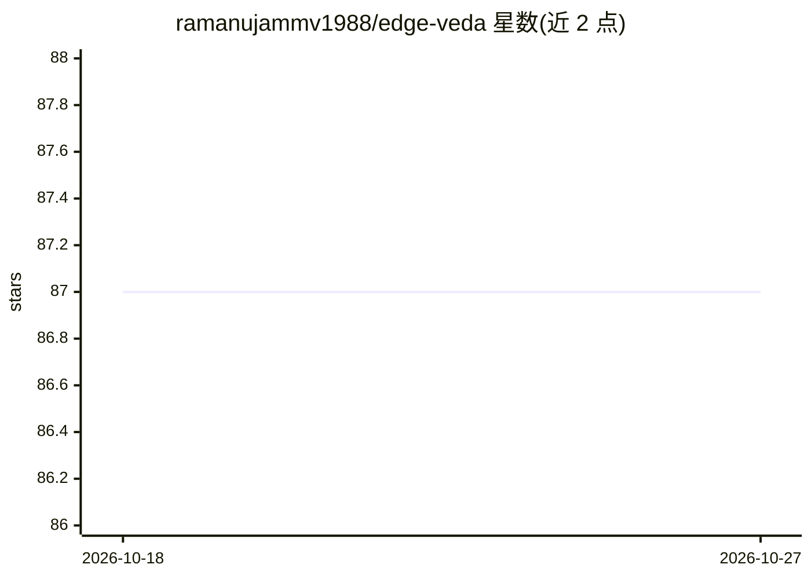

# ramanujammv1988/edge-veda

⭐ 87 · Dart · Apache-2.0 · 推送 2026-06-23 · [GitHub](https://github.com/ramanujammv1988/edge-veda) · [官网](https://pub.dev/packages/edge_veda) · 个人维护

**面向 Flutter 的 iOS 端侧 AI 运行时 SDK：推理/语音/图像/RAG 全离线**

一个用 Dart 编写的 iOS 端侧 AI SDK，通过后台 isolate 运行 llama.cpp、whisper.cpp、stable-diffusion.cpp 等模型，提供文本/视觉推理、流式转录、TTS、图像生成、嵌入与 RAG 管线、函数调用与 GBNF 结构化输出。面向 Flutter 开发者，特色是运行时监督：热/内存/电量感知调度、计算预算契约、跨 worker 内存回收与 JSONL 性能追踪，验证过 28 分钟以上长会话。附 Claude Code MCP 插件自动化脚手架与 4 个示例应用。仅支持 iOS（Metal GPU），Android 在路线图中。

## 筛选速览

| 维度 | 判定 | 备注 |
|---|---|---|
| AI 角色 | `ai-ecosystem` | LLM/agent 周边工具 |
| 许可风险 | `permissive` | Apache-2.0 |
| 部署形态 | `library` | 以包/库形式分发 |
| 模型依赖 | local-ok | 支持本地模型 |
| 硬件要求 | — | 无带数字的原话,不猜 |
| 安装摩擦 | `medium` | 含编译或系统依赖之一 |
| 成熟度 | — | 结构信号不足 |

## 能力要点

- 端侧全栈：文本/视觉推理、STT（whisper.cpp/Metal）、TTS、文生图（stable-diffusion.cpp）、嵌入与 RAG
- 运行时监督：热/内存/电量感知策略、计算预算契约、优先级降级与跨 worker 内存回收
- GBNF 语法约束生成、函数调用、JSON 修复与 per-token 置信度评分
- Claude Code MCP 插件一键脚手架与设备部署，含 4 个示例应用

## 适用场景

- 在 iOS 应用中构建完全离线、隐私默认的聊天与文档问答
- 端侧语音管线（录音→转录→LLM→TTS）的语音日记/助手类应用
- 对延迟与电量有约束的长期会话端侧 AI 场景

## 场景标签

`推理引擎` `RAG` `语音识别` `语音合成` · 领域:内容生成

## 证据(README 行号)

> L64: Edge-Veda is a **supervised on-device AI runtime** that:
> L66: - Runs **text, vision, and speech models fully on device**
> L71: - Supports **structured output, function calling, embeddings, and RAG**

## 星数曲线

2026-10-18 87 → 2026-10-27 87（+0）

---
*卡片 v1 · prompt 1.4 · 生成 2026-10-23 · 置信度 high · 依据 README sha `3369da895c26` · [字段定义](../../DATASET.md)*
