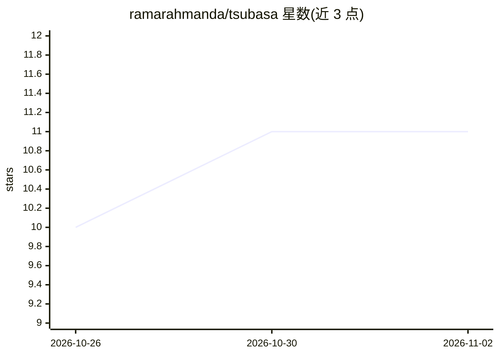

# ramarahmanda/tsubasa

⭐ 11 · Python · MIT · 推送 2026-08-28 · [GitHub](https://github.com/ramarahmanda/tsubasa) · 个人维护

**给工程团队的仓库内 AI 记忆：用 git 中的知识图谱让 agent 引用而非猜测**

以 Claude Code 插件 + CLI 形式提供的工程知识管理层：tsubasa init 在仓库内脚手架生成 .tsubasa/ 目录，从 git 历史、ADR、postmortem、PR 等来源摄取知识，构建事件/实体/关系/目标的知识图谱（TOON 纯文本格式，附 JSON Schema），随 git 提交与仓库一起分发。答案附带引用，或输出“不知道”。graphify 从 AST 索引代码结构，与原生图谱通过共享 ID 连接。README 给出基准测试数据（错误答案 −47%、成本 −40%），需 Python 3.11+、Claude Code、uv、git。

## 筛选速览

| 维度 | 判定 | 备注 |
|---|---|---|
| AI 角色 | `ai-ecosystem` | LLM/agent 周边工具 |
| 许可风险 | `permissive` | MIT |
| 部署形态 | `library` | 以包/库形式分发 |
| 模型依赖 | locked-api |  |
| 硬件要求 | — | 无带数字的原话,不猜 |
| 安装摩擦 | `low` | 无编译、无系统依赖或容器化 |
| 成熟度 | — | 结构信号不足 |

## 能力要点

- 双图谱设计：graphify（AST 代码索引）+ 原生图谱（ADR/事件/决策），共享 ID 连接
- 知识以纯文本 TOON 文件存于 .tsubasa/，随 git 提交、克隆即得、diff 即改
- 内置 5 个技能：onboard/recall/capture/inject/delegate
- CLI 提供 query --as-of 时间点查询与 --unanchored 反向约束查询

## 适用场景

- 新人或 CI 里的 agent 回答“为什么这样决策”时给出带引用的答案
- 把口头决策沉淀为可审查的 ADR 事件，替代散落在各人脑中的组织记忆
- 非 Claude 客户端通过 CLI 在脚本/CI 中查询知识图谱

## 场景标签

`Agent 记忆` `知识图谱` · 领域:Agent 开发

## 证据(README 行号)

> L7: Stars PyPI Python 3.11+ Claude Code plugin License: MIT
> L85: **Requirements:** Claude Code · uv · git

## 星数曲线

2026-10-26 10 → 2026-11-02 11（+1）

---
*卡片 v1 · prompt 1.4 · 生成 2026-11-01 · 置信度 high · 依据 README sha `fb93092def9b` · [字段定义](../../DATASET.md)*
