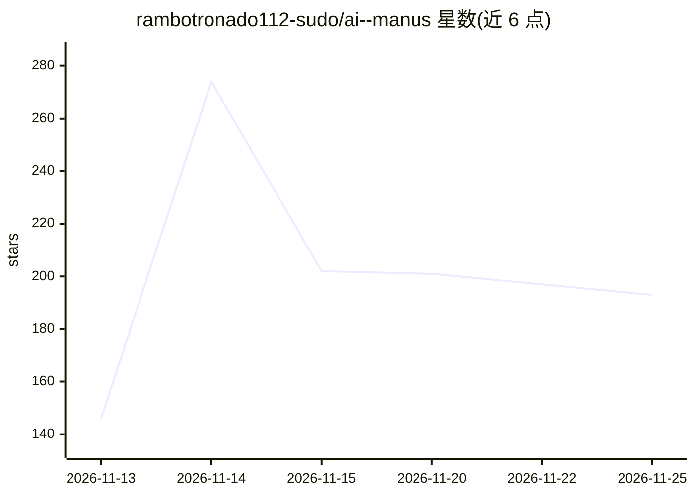

# rambotronado112-sudo/ai--manus

⭐ 193 · Apache-2.0 · 推送 2026-11-15 · [GitHub](https://github.com/rambotronado112-sudo/ai--manus) · 个人维护

**面向日常任务的自主 AI Agent：可执行代码并控制浏览器**

Manus 是一个自主 AI agent，按描述可在沙箱中运行代码、控制浏览器（导航页面、填写表单、收集信息），并执行多步骤任务，定位为家庭、学习与轻量办公场景的个人助手，而非企业平台。README 说明其在会话间保持任务模式一致，脚本与浏览器操作可衔接。但 README 未给出具体技术架构、模型接入方式或安装运行命令，仅提供硬件兼容表与使用步骤建议，可验证的技术信息有限。

## 筛选速览

| 维度 | 判定 | 备注 |
|---|---|---|
| AI 角色 | `ai-native` | 本体是模型或模型工具 |
| 许可风险 | `permissive` | Apache-2.0 |
| 部署形态 | `None` |  |
| 模型依赖 | — | README 未给出锁定关系 |
| 硬件要求 | — | 无带数字的原话,不猜 |
| 安装摩擦 | `low` | 无编译、无系统依赖或容器化 |
| 成熟度 | — | 结构信号不足 |

## 能力要点

- 自主执行代码与控制浏览器（导航、填表、采集信息）
- 支持多步骤任务，脚本与浏览器操作可衔接
- 声明面向家庭/学习/轻量办公的小规模场景
- 提供硬件兼容要求表（最低 4 GB RAM）

## 适用场景

- 让学生整理研究笔记并运行小脚本
- 远程工作者从多个网页收集数据
- 把重复性的小任务交给后台 agent 处理

## 场景标签

`AI 助手` `浏览器自动化` · 领域:效率与自动化

## 证据(README 行号)

> L10: - **Autonomous Code Execution:** Manus AI agent runs code on its own to complete tasks, so you can focus on decisio
> L18: Manus is an autonomous AI agent designed to run code and control a browser on your behalf. Instead of acting like a

## 星数曲线

2026-11-13 146 → 2026-11-25 193（+47）

---
*卡片 v1 · prompt 1.4 · 生成 2026-11-17 · 置信度 low · 依据 README sha `fbfd5e977bf4` · [字段定义](../../DATASET.md)*
