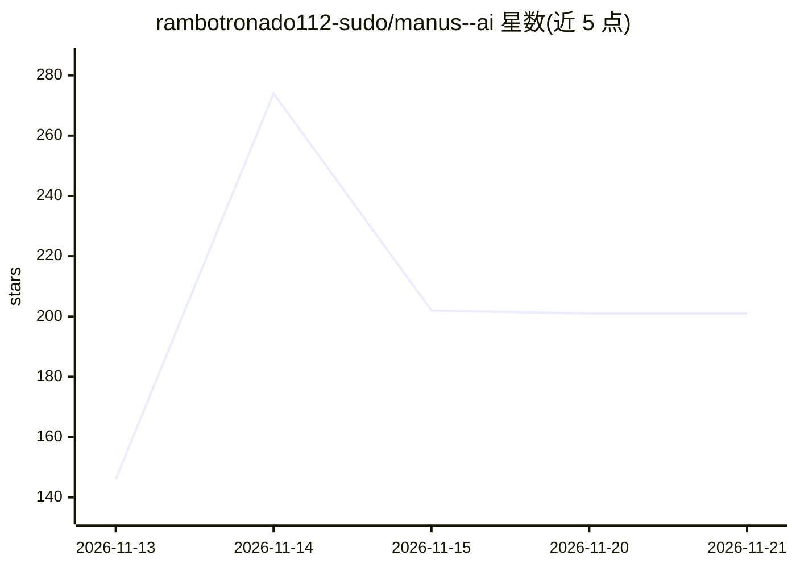

# rambotronado112-sudo/manus--ai

⭐ 201 · Apache-2.0 · 推送 2026-11-15 · [GitHub](https://github.com/rambotronado112-sudo/manus--ai) · 个人维护

**自主 AI Agent：代用户执行代码与控制浏览器完成多步任务**

定位为自主运行的 AI 助手：接收自然语言指令后自动编写并执行脚本、控制浏览器（导航、填表、采集信息），完成多步骤任务，可在后台持续待命并跨会话复用工作流模式。面向家庭、学习与轻量办公场景的使用者，无需编程背景。README 说明其对小规模任务的设计取向，并列出最低双核 CPU/4 GB 内存的兼容性配置。全文为功能描述与使用步骤，未提供代码仓库结构、模型来源或具体安装命令。

## 筛选速览

| 维度 | 判定 | 备注 |
|---|---|---|
| AI 角色 | `ai-native` | 本体是模型或模型工具 |
| 许可风险 | `permissive` | Apache-2.0 |
| 部署形态 | `None` |  |
| 模型依赖 | — | README 未给出锁定关系 |
| 硬件要求 | — | 无带数字的原话,不猜 |
| 安装摩擦 | `low` | 无编译、无系统依赖或容器化 |
| 成熟度 | — | 结构信号不足 |

## 能力要点

- 自主编写并执行代码完成任务
- 浏览器控制：导航网页、填写表单、采集信息
- 代码与浏览器动作可在同一任务流程中衔接
- 跨会话记忆工作流模式，减少重复说明

## 适用场景

- 让学生整理研究资料、跑小脚本而不必学编程
- 让远程办公者从多个网页自动收集信息
- 把重复性的小型日常任务交给后台 agent 处理

## 场景标签

`浏览器自动化` `编码 Agent` `AI 助手` · 领域:效率与自动化

## 证据(README 行号)

> L10: - **Autonomous Code Execution:** Manus AI agent runs code on its own to complete tasks, so you can focus on decisio
> L18: Manus is an autonomous AI agent designed to run code and control a browser on your behalf. Instead of acting like a

## 星数曲线

2026-11-13 146 → 2026-11-21 201（+55）

---
*卡片 v1 · prompt 1.4 · 生成 2026-11-17 · 置信度 mid · 依据 README sha `0f78ee3a5dd2` · [字段定义](../../DATASET.md)*
