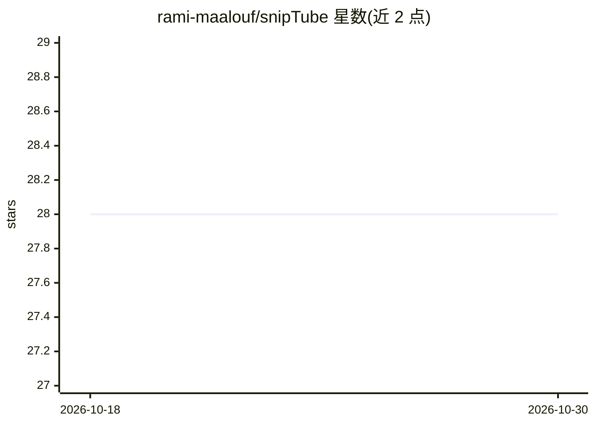

# rami-maalouf/snipTube

⭐ 28 · TypeScript · MIT · 推送 2026-06-04 · [GitHub](https://github.com/rami-maalouf/snipTube) · [官网](https://sniptube.vercel.app) · 个人维护

**浏览器扩展：高亮、标记、导出 YouTube 视频片段并用 AI 生成摘要**

面向学生、研究者与普通 YouTube 用户的浏览器扩展：对视频中的片段（snips）做高亮、自定义标签与注释，整理为可回访的收藏集，并可导出为 Markdown 导入笔记应用（作者演示与 Zettelkasten 笔记系统集成）。AI 功能为对片段自动生成摘要，后端用 FastAPI 处理 AI 相关端点，通过 LangChain 调用 GPT-3.5-turbo 实现摘要；扩展本体基于 Plasmo 与 React 构建。提供 Chrome/Firefox/Edge/Safari 商店下载渠道。

## 筛选速览

| 维度 | 判定 | 备注 |
|---|---|---|
| AI 角色 | `ai-enhanced` | 去掉 AI 部分产品仍成立 |
| 许可风险 | `permissive` | MIT |
| 部署形态 | `None` |  |
| 模型依赖 | — | README 未给出锁定关系 |
| 硬件要求 | — | 无带数字的原话,不猜 |
| 安装摩擦 | `low` | 无编译、无系统依赖或容器化 |
| 成熟度 | `idea` | |

## 能力要点

- 对视频片段做高亮、标签、注释并生成 AI 摘要
- 单个片段或整个收藏集可导出为 Markdown
- 支持 Chrome/Firefox/Edge/Safari 四个浏览器商店分发
- 技术栈：Plasmo + React 扩展前端，Next.js + FastAPI 后端

## 适用场景

- 收藏并标注长视频中的关键片段以便回看
- 把视频要点导出到笔记应用（如 Zettelkasten）
- 用 AI 摘要快速回顾视频片段内容

## 场景标签

`知识库管理` · 领域:知识与检索

## 证据(README 行号)

> L19: Are you tired of trying to remember the best moments in those lengthy YouTube videos? Look no further! SnipTube emp
> L25: 🎯 **Intelligent Summarization**:
> L71:  - LangChain for enhancing and simplifying the process of interacting with LLMs like GPT-3.5-turbo (which is what I

## 星数曲线

2026-10-18 28 → 2026-10-30 28（+0）

---
*卡片 v1 · prompt 1.4 · 生成 2026-10-26 · 置信度 high · 依据 README sha `8a6b6ce926e5` · [字段定义](../../DATASET.md)*
