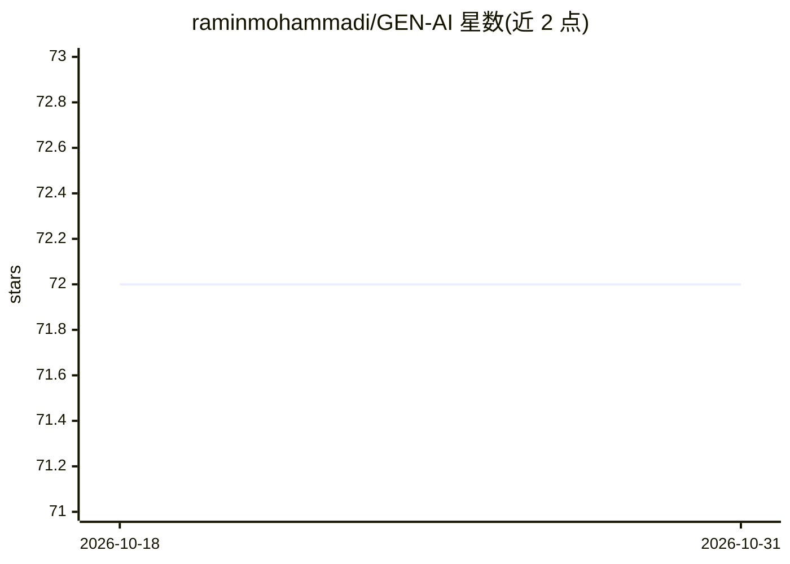

# raminmohammadi/GEN-AI

⭐ 72 · Jupyter Notebook · CC0-1.0 · 推送 2026-07-30 · [GitHub](https://github.com/raminmohammadi/GEN-AI) · [官网](https://www.mlwithramin.com/) · 组织维护

**东北大学深度生成模型课程的实验与阅读材料集**

Northeastern University DADS 7650 课程仓库，收录深度生成模型课程的实验（labs）与阅读材料，主题覆盖神经网络、Transformer、能量/评分模型、流归一化、GAN、VAE、扩散模型、RLHF 与图神经网络。每个实验包含说明、代码示例与练习，使用方式为克隆仓库后进入具体实验目录按文档操作。先修要求包括机器学习课程、Python、TensorFlow 与数学基础。阅读材料按 Creative Commons 许可收集，仓库采用 MIT 许可。

## 筛选速览

| 维度 | 判定 | 备注 |
|---|---|---|
| AI 角色 | `ai-knowledge` | 知识聚合/清单类 |
| 许可风险 | `viral` | CC0-1.0 |
| 部署形态 | `None` |  |
| 模型依赖 | — | README 未给出锁定关系 |
| 硬件要求 | — | 无带数字的原话,不猜 |
| 安装摩擦 | `low` | 无编译、无系统依赖或容器化 |
| 成熟度 | — | 结构信号不足 |

## 能力要点

- 课程实验覆盖 GAN/VAE/扩散模型/Transformer/RLHF/GNN 等主题
- 每个实验含说明、代码示例与练习
- 材料面向计算机视觉、NLP、社交网络分析与推荐系统项目

## 适用场景

- 跟随课程系统学习深度生成模型
- 获取各主题的实验代码与练习
- 作为生成模型教学的参考材料

## 场景标签

`教程课程` · 领域:学习与行业

## 证据(README 行号)

> L3: # DADS 7650 - Deep Generative Models
> L35: The labs in this repository are designed to provide hands-on experience with the concepts covered in the course. Ea

## 星数曲线

2026-10-18 72 → 2026-10-31 72（+0）

---
*卡片 v1 · prompt 1.4 · 生成 2026-10-24 · 置信度 high · 依据 README sha `d2ada08ddcdb` · [字段定义](../../DATASET.md)*
